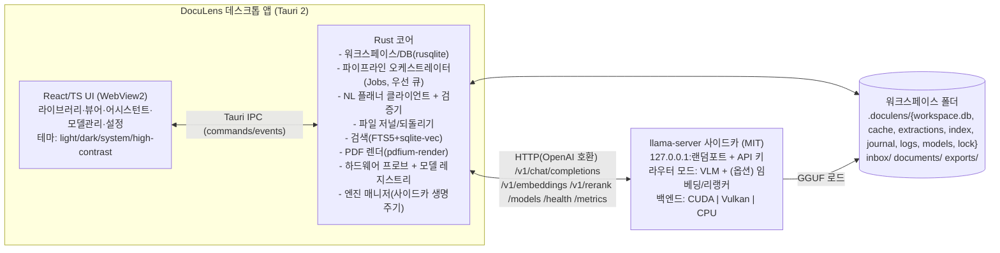

# VLM 기반 오프라인 문서처리 데스크톱 클라이언트 설계안 (가칭 **DocuLens**)

- 작성일: 2026-11-03 · 버전: **v1.1 (사용자 피드백 반영본 — 구현 기준 문서; 지식 베이스 중심 기능 §3.14·프로젝트 정합성 §3.15 추가)**
- 상태: **피드백 반영 완료 → P0 구현 착수 대기**. 결정 사항은 §0.1 "결정 기록" 참조. 이전 버전(v0.9~v0.93)의 선택지 서술은 결정된 내용으로 치환했습니다.
- 근거 자료: 모델 후보군/벤치마크/VRAM/소프트웨어 라이선스/선행사례/데스크톱 스택에 대한 1차 출처(GitHub, PyPI, crates.io, 공식 문서) 기반 조사 + 3인 독립 선정 패널 + 반론 검증 + 독립 리뷰(기술/라이선스/GUI 완전성). 출처 URL은 부록 A. **huggingface.co 는 조사 세션에서 접근이 차단되어 모델 카드 원문은 검색 요약·GitHub 미러로 확인했으며, 해당 항목은 "미확인"으로 표시**했습니다(부록 B).

---

## 0. 요약 (Executive Summary)

| 결정 항목 | 결론 |
|---|---|
| **기본 모델 (8 GB VRAM 티어)** | **Qwen3.5-4B** (Apache-2.0, 2026-03-02 공개, 비전 내장(natively multimodal), 262K 컨텍스트). GGUF **Q4_K_M ~ Q6_K** + `mmproj-F16` 를 llama.cpp로 구동. 8K 컨텍스트+A4 1페이지 기준 **≈4.3 GiB(Q4_K_M) ~ 5.2 GiB(Q6_K)**, 32K 컨텍스트에서도 **≈4.6 ~ 5.5 GiB(q8_0 KV)** → 8 GB 카드에서 1.5~3 GiB 여유. |
| **대체(fallback) 모델** | **Qwen3-VL-4B-Instruct** (Apache-2.0, 공식 GGUF 존재). Qwen3.5의 선형어텐션(GDN) 커널이 문제를 일으키는 GPU(Turing 등)나, 자체 한국어 평가에서 더 좋게 나올 경우 전환. |
| **상위 사양 티어** | 같은 Qwen 패밀리로 사다리 구성: 12 GB → Qwen3.5-9B, 16 GB → Qwen3.5-9B(Q6/Q8), 24 GB+ → Qwen3.5-27B(향후 Qwen3.6/3.8-27B 검증 후 추가). CPU 전용 → Qwen3.5-2B. |
| **앱 형태** | **Windows 전용**(단일 OS) 완전 오프라인 데스크톱 클라이언트. **Tauri 2 (Rust 코어) + React/TypeScript UI + llama.cpp `llama-server` 사이드카(127.0.0.1 전용, 앱이 생명주기 관리)**. 서버 배포 아님. GPU는 **CUDA 12.1~12.9 환경**을 대상으로 CUDA 팩 2종(12.1 툴킷 빌드 / 12.9 툴킷 빌드)을 드라이버에 맞춰 자동 선택, Vulkan·CPU 폴백. |
| **모델 교체/티어링** | 모델 레지스트리(JSON 매니페스트) + 하드웨어 자동 감지(VRAM/벤더/RAM) → 티어별 기본 모델 자동 선택, 사용자 수동 변경, 재시작 없는 핫스왑(llama-server 라우터 모드). GGUF 오프라인 임포트 1급 지원. |
| **자연어 처리** | §3.7.3 전수표의 **모든 단계(31개)** 가 GUI 컨트롤과 자연어 op 양쪽으로 호출 가능. 명령 → **타입이 고정된 JSON 플랜**(문법 제약 디코딩, 부록 D op 집합) → 검증 → 미리보기/확인 → 작업(job) 실행 → 저널 기반 되돌리기. 아울러 분류·OCR·추출·Q&A 같은 단계 자체가 VLM(자연어 모델) 기반으로 처리됨. |
| **워크스페이스** | 설정 파일(`settings.json`)에 지정된 로컬 폴더(GUI에서도 변경) 안에 숨김 디렉터리 `.doculens/` (SQLite DB, 페이지 캐시, 추출 결과, 인덱스, 저널, 로그, **모델**) 생성. 상대경로만 저장 → 폴더 이동/USB 휴대 가능. 모델 교체는 **`models/` 폴더에 GGUF+mmproj를 넣는 것만으로** 자동 인식·등록(드롭인), GUI 가져오기는 보조. |
| **문서 유형·스키마** | 기본값은 **사용자가 워크스페이스(RAG)에 등록한 양식 문서**에서 자동 생성(양식 등록 → VLM이 유형명·필드 스키마 도출 → 사용자 확인). 내장 6종(세금계산서·영수증·사업자등록증·계약서·신청서·일반)은 시작점 샘플로만 제공. |
| **지식 베이스(사전지식 RAG)** | 규정·지침·양식·과거 문서·FAQ를 **미리 대량 적재·색인**(변환→청킹→형태소 FTS+임베딩)해 두고, 모든 작성·요약·설명·질의가 이 지식을 근거로 동작. 근거 인용 필수, 근거 없으면 "지식 베이스에 근거 없음" 명시(§3.14). 임베딩 모델(bge-m3 또는 KURE-v1, MIT, CPU)을 **기본 설치**로 승격. |
| **문서 자동 생성** | 한국어 자연어로 "형식(등록 양식 또는 설명) + 내용"을 입력하면 VLM이 **지식 베이스에서 관련 규정·유사 과거 문서를 검색해 근거로 삼아** 초안을 작성, 등록 양식(HWPX/DOCX)을 채우거나 새 문서(HWPX/DOCX/PDF/Markdown)를 생성, GUI에서 미리보기·수정 후 저장(§3.13). |
| **요약·설명** | 단일/다중/컬렉션 요약(개조식·서술식·표·비교 요약), 뷰어에서 드래그한 용어·문장을 "이게 뭐야?"로 기존 문서 기반 설명, 모든 답변에 출처 링크(§3.14). |
| **프로젝트 정합성 검증** | 케이스(심사 건·거래처 건)별로 문서 묶음을 만들고 필수 문서 체크리스트·문서 간 정합성 규칙(자연어로 정의)을 검사 → 누락/불일치 리포트 → 보완요청서 자동 생성(§3.15, DocuOps 참고). |
| **입력 형식** | PDF·JPG·PNG·TIFF·WebP + **HWP 5.0·HWPX**(파서 → HTML → WebView2 PDF 인쇄 → 기존 PDF 파이프라인). *2026-11-09 추가(사용자 요청): DOCX(P2)·XLSX·PPTX·텍스트 계열(TXT/MD/CSV/TSV/LOG/JSON/XML/HTML)도 같은 경로로 변환하고, 가져오기 때 확장자 대신 내용(매직 바이트·컨테이너 항목)으로 형식을 판정한다 — `docs/HANDOFF.md` "입력 형식 확장·알 수 없는 형식 처리" 참조.* |
| **보존·파기** | 문서·추출 결과·로그·저널·마스킹 데이터의 보존 기간을 **설정 GUI**에서 지정, 만료 시 파기 작업 자동 실행(§3.8). |
| **DB** | SQLite(퍼블릭 도메인) 단일 파일 + FTS5(한국어 형태소+trigram) + sqlite-vec(벡터). 서버 DB 없음. |
| **테마** | 라이트 / 다크 / 시스템 연동 / 고대비(추가) — CSS 변수 기반 디자인 토큰, 설정 영구 저장. |
| **라이선스 정책** | 허용: Apache-2.0 / MIT / BSD-2/3 / ISC / PSF / zlib / Unlicense·CC0·퍼블릭 도메인 / OFL-1.1(폰트) / BSL-1.0(Boost) / Unicode-3.0 / FTL / IJG / CDLA-Permissive-2.0 / Apache-2.0 WITH LLVM-exception; MPL-2.0은 미수정 사용 시에만. 배제: GPL·LGPL(동적 링크 포함)·AGPL·SSPL·BUSL·MS-RL·CC-BY-NC·커스텀 제한 라이선스(Gemma ≤3(Gemma 4는 Google 공식 블로그의 Apache-2.0 명시는 확인됐으나 HF 카드 게이팅·사용정책 미확인, 한국어 증거 없음 → 보류), Llama, MiniCPM ≤4.0, LFM, NVIDIA Open Model License, HyperCLOVA, Kanana, Hunyuan, OpenRAIL-M, MinerU OSL, Open WebUI, Lobe Chat, Slint, PySide6/PyQt, PyMuPDF, poppler, Nuitka, WiX 등). **문서화된 독점 예외 3가지**: (a) NVIDIA CUDA 런타임 DLL(cudart/cublas/cublasLt — CUDA EULA Attachment A 재배포 허용, 소스공개 의무 없음, **선택 설치 팩**), (b) Windows 오프라인 설치판에 동봉하는 Microsoft Edge WebView2 Runtime 설치기(Microsoft 소프트웨어 라이선스, 미수정 재배포), (c) 미동봉·미수정 Windows 시스템 런타임에 대한 동적 링크(UCRT/vcruntime). macOS/Linux는 범위 외. MPL-2.0 미수정 사용과 CUDA 런타임 번들은 **허용으로 결정**(2026-11-03). |

### 0.1 결정 기록 (2026-11-03 사용자 피드백)
| # | 항목 | 결정 |
|---|---|---|
| 1 | 대상 OS | **Windows 단일** (macOS/Linux 범위 외) |
| 2 | 코어 언어 | **Rust** (Tauri 2) + TypeScript UI |
| 3 | 엔진 통합 | 권장안 — **llama-server 사이드카**(루프백, 앱이 관리) |
| 4 | 모델 보관 위치 | **워크스페이스 내부** `.doculens/models/` |
| 5 | 8 GB 양자화 | **적응형**(Q6_K/Q5_K_M/Q4_K_M, free VRAM 기준) |
| 6 | 대체 모델 | 사용자가 오픈 LLM 저장소에서 별도로 받아 **지정 폴더에 모델 파일을 넣어 교체**(드롭인 폴더, §3.3.5). 구현이 어려운 경우 GUI 가져오기(권장안)로 대체 |
| 7 | 문서 유형·우선순위 | **사용자가 RAG(워크스페이스)에 등록한 문서의 이름·양식을 기본값으로** 자동 선정(§3.4.1) |
| 8 | 골든셋 | 사용자가 제공 |
| 9 | 온라인 모델 다운로드 | 권장안 — 포함(온라인일 때만 활성) |
| 10 | MPL-2.0 미수정 사용·CUDA 번들 | 허용 |
| 11 | 제품명 | 가칭 "DocuLens" 유지, 추후 변경 |
| 12 | 언어 | **UI·명령 모두 한국어 기본**, 영어도 사용 가능. **문서 자동 생성**도 한글 기반(형식+내용 자연어 입력 → 자동 작성, §3.13) |
| 13 | GPU | **CUDA 12.1 ~ 12.9** 환경 지원(§3.12 CUDA 팩 2종) |
| 14 | 워크스페이스 위치 | **설정 파일에서 지정**(GUI 설정 화면과 양방향 동기화, §3.6) |
| 15 | HWP/HWPX | **입력 지원**(§3.4 입력 형식), 생성은 HWPX(§3.13) |
| 16 | 보존/파기 기간 | **설정 GUI**에서 지정(§3.8) |
| 17 | 지식 베이스 중심 동작 | **사전지식(규정·지침·양식·과거 문서)을 RAG로 미리 적재**하고, 문서 작성·요약·"모르는 것 설명"이 모두 이 지식을 근거로 동작(출처 인용 필수, 근거 없으면 명시) — §3.14. 임베딩 모델 기본 설치 |
| 18 | DocuOps 참고 기능 | 프로젝트(케이스) 단위 다중 문서 분석·정합성 규칙 검증·보완요청서 생성·접수 상태 보드 — §3.15 |
| — | 세부 기본값(§5.2의 13~31) | 이견 없음 → 권장안 적용 |

---

## 1. 요구사항 정리와 가정

### 1.1 요구사항(원문 → 해석) — 번호는 요구사항 브리프(R1~R12)와 동일

| # | 원문 | 해석 / 설계 반영 |
|---|---|---|
| R1 | 오픈소스·오픈가중치 모델 중 8 GB VRAM에서 *여유롭게* 추론 가능한 모델 1개 선정, VLM 기반 문서처리 시스템 설계 | "여유롭게" = 양자화 가중치 + 비전 프로젝터 + 8K~32K KV 캐시 + 페이지 이미지 활성화를 합쳐 **≤ ~6.5 GiB**(8 GiB 중). 영구 선정 모델 1개 + 동일 패밀리 사다리. |
| R2 | 클라이언트 SW 내 오프라인 동작, 서빙 아님 | 네트워크 없이 동작. 추론 엔진은 앱이 띄우는 **루프백 전용 사이드카 프로세스**(사용자에게 보이지 않음) 또는 인프로세스 바인딩. 시작 시 네트워크 호출 0건. |
| R3 | 모델 교체 구조, 고사양이면 고성능 모델 참조 | 레지스트리 + 하드웨어 티어링 + 핫스왑 + 임포트 시 GGUF 검증. |
| R4 | 모든 파이프라인에서 자연어 기반 처리 지원 | 두 가지 의미를 모두 충족: (a) 모든 단계가 GUI 버튼과 **자연어 명령 양쪽**으로 호출 가능(§3.7.3 전수표, 부록 D), (b) 분류·OCR·추출·Q&A 등 단계 자체가 자연어 모델(VLM)로 처리. 한국어·영어 명령 지원. |
| R5 | 로컬 폴더 선택, 그 안에 추론·문서정리 데이터 저장 | 워크스페이스 폴더(Obsidian vault 유사). 모델도 워크스페이스에 둘 수 있음(기본) / 전역 공유 저장소 선택 가능. 이동 가능, 다중 워크스페이스. |
| R6 | 필요시 DB 사용 가능 | 임베디드 SQLite(메타데이터·필드·검토 상태·작업·대화·FTS·벡터). |
| R7 | Python/Rust 등 GPU 친화 언어 | Rust 코어(+TypeScript UI). Python 대안 스택 병기(§3.2). 모든 의존성 허용 라이선스. |
| R8 | 다크·화이트 2개 이상 테마 | 라이트/다크/시스템/고대비 4종, 영구 저장(§3.7.4). |
| R9 | 온라인/오픈소스 UI 디자인 차용 가능, 요구 기능 전부 GUI에서 동작 | 허용 라이선스 프로젝트(Jan, AnythingLLM, LibreChat, Label Studio, shadcn/ui 등)에서 코드/디자인 차용; 카피레프트 프로젝트는 디자인 참고만. §3.7.3에 **단계→GUI→자연어 전수표** 제공. |
| R10 | 설계안 출력 후 피드백 받아 실행 | 본 문서 → 피드백(§5.0 방식) → 구현(§4). |
| R11 | 한국어+영어 비즈니스 문서(세금계산서·영수증·사업자등록증·계약서·신청서·표·차트), 스캔/사진/디지털 PDF, 다중 페이지; 한국어·영어 UI | §3.4 파이프라인, §3.4.1 내장 스키마 6종, i18n(ko/en). |
| R12 | Windows 우선, 단일 사용자, 프라이버시, OOM 완화, 오프라인 설치, 설치 크기, 엔진 크래시 격리 | §3.8 보안, §3.10 복구, §3.12 패키징, §3.6 잠금/백업. |
| 선호 | 코드 공개 의무 없는 오픈소스만 사용 | §3.2 BOM과 부록 C 회피 목록. |

### 1.2 확정된 전제 (피드백 반영)
1. **대상 OS**: Windows 11(및 10) 단일. WebView2(OS 구성요소) 사용, 한국어 IME 안정. 개발 중 Linux 빌드는 CI 테스트 용도로만 사용(배포 없음).
2. **대상 GPU**: NVIDIA RTX 3070 / 4060 / 4060 Ti 8 GB 급, **CUDA 12.1~12.9 드라이버 환경**(12.1 툴킷 빌드 팩으로 전 구간 호환, 12.8+ 드라이버·RTX 50은 12.9 빌드 팩). AMD/Intel은 Vulkan 경로. 시스템 RAM 16~32 GB.
3. **문서**: 한국어+영어 비즈니스 문서 — 유형과 스키마의 기본값은 사용자가 등록한 양식에서 생성; 내장 샘플 6종. 스캔 PDF·휴대폰 사진·디지털 PDF·**HWP/HWPX** 혼재, 다중 페이지.
4. **사용자**: 단일 사용자 PC, 데이터는 PC 밖으로 나가지 않음. 골든셋(마스킹된 실제 문서)은 사용자가 제공.
5. **처리량**: 수십~수천 페이지 배치 + 대화형 질의 + 문서 초안 생성. GPU 1장.

---

## 2. 모델 선정

### 2.1 선정 기준
1. **라이선스**: 가중치가 Apache-2.0/MIT/BSD (사용 제한·소스공개 의무 없음). 커스텀 "오픈" 라이선스는 탈락.
2. **8 GB 여유 적합성**: 위 ≤6.5 GiB 기준을 **llama.cpp GGUF + 비전(mmproj)** 경로에서 충족. llama.cpp 비전 미지원 모델은 기본 모델에서 제외(데스크톱 배포에 현실적인 엔진이 llama.cpp뿐).
3. **문서 정확도**: OCR→Markdown 충실도, JSON KIE(키-값 추출), 표/차트 이해, 장문/다중페이지 QA.
4. **한국어**: 한글 OCR 충실도(FaithC4 Korean WER, MDPBench-KO), 한국어 문서 VQA 증거.
5. **생태계**: GGUF/프로젝터 공개 여부, 엔진 버그 상태, JSON 스키마 제약 디코딩·도구 호출 안정성, 채팅 템플릿 안정성.
6. **티어링**: 같은 패밀리로 CPU~24 GB+까지 사다리 구성 가능(프롬프트·템플릿·도구 포맷 공유).
7. **범용 지시 수행**: 자연어 명령 플래닝·Q&A도 같은 모델이 해야 하므로 OCR 전용 모델(PaddleOCR-VL, GLM-OCR 등)은 단일 모델 후보에서 제외(선택적 애드온으로만 고려).

### 2.2 후보 비교 (≤10B, 2026-11-03 기준)

| 모델 | 라이선스 | 8 GB 적합(llama.cpp, 비전 포함) | 문서 벤치(출처 표기) | 한국어 증거 | 판정 |
|---|---|---|---|---|---|
| **Qwen3.5-4B** (2026-03) | Apache-2.0 (GitHub 저장소 LICENSE 확인; 가중치 HF 카드는 검색요약 — 사이즈별 개별 확인 필요, 부록 B-1) | **여유** — Q4_K_M 측정치 GPU 2.52 GiB + 호스트 0.49 GiB(RTX 3060 Ti 8 GB, Ollama 이슈 #17386); KV 32 KiB/토큰(F16) → 32K에 1.0 GiB (4B 하이퍼파라미터는 공개된 llama-server 로그로 확인: hidden 2560, 16 Q/4 KV 헤드, head_dim 256, full_attention_interval 4, GDN 구성 9B와 동일; ViT는 24층×1024로 9B보다 작음 — 로컬 재확인은 부록 B-2); 9B GGUF 메타데이터 `general.license=apache-2.0` 확인 | OCRBench 85.0(자체)/86.6(Xiaomi 3rd), OmniDocBench v1.5 86.2(자체), DocVQA 94.4·InfoVQA 80.4·ChartQA 82.4(Xiaomi 3rd), CharXiv-RQ 70.8, MMLongBench-Doc 54.2(자체), Nanonets IDP KIE 86.0(검색 요약, 미확인) | FaithC4 한국어 WER **6.46%**(15개 시스템 중 2위; arXiv 차단으로 검색 추출치, 열 매핑 미확인) | **선정** |
| Qwen3-VL-4B-Instruct (2025-10) | Apache-2.0 (저장소 확인, HF 카드 미확인) | 8K~16K에서 여유(≈5.3(8K)~5.9(16K, q8_0 KV) GiB), 32K는 KV 144 KiB/토큰 때문에 q8_0 KV+Q8 mmproj로 ≈6.3~6.5 GiB(빠듯) | OCRBench 881, DocVQA 95.3, OmniDocBench v1.5 86.78(Qianfan 재평가) | FaithC4 KO WER 6.99%, KO-VQA 38.47 / KO-OCRAG 50.21 | **대체 모델** |
| Qwen3.5-9B | Apache-2.0 | **빠듯/불가** — UD-Q4_K_XL 측정 5.01 GiB GPU + mmproj 1.1 GiB + 연산 → ≈7.0 GiB@8K | OCRBench 89.2(자체), IDP KIE 86.5(Nanonets 3rd, GPT-5.4 이상), CharXiv 73.0 | MDPBench-KO 60.3(3rd) | 12/16 GB 티어 |
| Qwen3-VL-8B-Instruct | Apache-2.0 | 불가(≈7.7 GiB@8K; 32K 불가) | OCRBench 896, DocVQA 96.1 | **KO-VQA 53.87 / KO-VDC 68.5 / KO-OCRAG 56.26** (신세대 범용 VLM 중 최고) | 12/16 GB 티어 한국어 대안 |
| Gemma 4 E4B-it (2026-04) | **Apache-2.0** (Google 공식 HF 블로그 명시 확인; HF 카드 게이팅·사용정책·LICENSE 파일은 미확인) | 여유(QAT q4_0 공식 GGUF; Ollama 로그 기준 GPU 2.8 GiB + PLE 테이블 ≈5.9 GiB는 CPU 매핑) | OmniDocBench v1.5 ED 0.181 외 문서 지표 거의 없음, 이미지 토큰 상한 1,120 | 증거 없음; Gemma-3 계열은 KO-OCRAG ≈0(12B 0.50) | 보류(한국어 검증 후 재고) |
| GLM-4.6V-Flash 9B | MIT 표기(카드 미확인; 저장소 코드는 Apache-2.0) | 불가(≈7.0~7.6 GiB; 28px/토큰이라 A4 2,772토큰) | ChartQAPro 62.6, OCRBench 84.7 | 없음; GLM-V 저장소 유지보수 중단(2026-09) | 제외 |
| InternVL3.5-4B/8B | Apache-2.0 | 4B는 8K 여유 | DocVQA 92.4, ChartQA 86 | **MDPBench-KO 30.3** (매우 약함) | 제외 |
| Ministral 3 3B/8B | Apache-2.0 | 3B 여유, 8B 불가 | 3B: OCRBench 73.5, DocVQA 89.6 | 공식 한국어 OCR 주장 없음(미확인) | 제외(문서 성능 낮음) |
| Molmo2-4B / Ovis2.5 | Apache-2.0 | llama.cpp 프로젝터 없음 | — | — | 제외 |
| Granite Vision 4.1-4B / Phi-4-mm / SmolVLM2 | Apache/MIT | 가능 | 영어 중심 | 영어 전용 | 제외 |
| MiniCPM-V 4.6 (1.3B) | Apache-2.0 (4.6부터) | 매우 여유 | OCRBench ≈876(디렉터리 사이트) | 없음 | 저사양 후보(검증 필요) |
| SK텔레콤 A.X 4.0 VL Light (7.4B) | Apache-2.0 표기(HF 카드 미확인; GitHub 저장소에 LICENSE 파일·라이선스 문구 없음 → 원문 확인 전 미확정) | **llama.cpp 변환기/프로젝터 없음**(커스텀 remote code), GGUF 없음 | 한국어 문서 VQA KoBizDoc 89.8, K-DTCBench 90.0(자체) | 한국어 특화 | 향후 옵션(≥12 GB, transformers/vLLM; 라이선스 확인 후) |
| Kanana-1.5-v / HyperCLOVA X SEED Vision / VARCO-VISION / EXAONE | 커스텀·NC | — | — | 한국어 특화 | 라이선스 탈락 |
| OCR 전용: PaddleOCR-VL-1.6 (0.9B, 프로젝트 Apache-2.0; 가중치 카드·GGUF 저장소 HF 미확인, 한국어 111개 언어, llama.cpp `paddleocr` 프로젝터 존재), GLM-OCR (0.9B, 가중치 MIT; llama.cpp 프로젝터 확인 필요), MonkeyOCRv2 (Apache-2.0, 한국어 MDPBench-KO 88.7; **vLLM 전용, llama.cpp 불가**) | 허용 | PaddleOCR-VL 여유 / GLM-OCR 확인 필요 / MonkeyOCRv2 불가 | OmniDocBench v1.6: 96.34 / 95.22 / 91.80 | 강함 | 단일 모델 불가(지시 수행 X) → **선택 애드온** |

### 2.3 최종 선정: **Qwen3.5-4B** — 근거

> (0.1~0.3 선정 기록. **0.4.0부터는 §2.8의 Gemma 4 사다리가 이 절을 대체한다** — 사용자 결정 2026-11-10 "중국계 LLM 제외".)
1. **8 GB에서 진짜 여유**: 하이브리드 구조(32층 중 **8층만 full attention**, 나머지 24층은 Gated DeltaNet 선형어텐션)라 KV 캐시가 토큰당 **32 KiB(F16)/17 KiB(q8_0)** — Qwen3-VL/InternVL 계열(144 KiB)의 1/4.5. 32K 컨텍스트가 1.0 GiB(q8_0이면 0.53 GiB)라서 **다중 페이지 컨텍스트**가 8 GB에서 성립. GDN 상태는 시퀀스당 ≈50 MiB 고정. (32 KiB/토큰은 9B 실측 로그와 4B 공개 로그(동일 4 KV 헤드 × 256, interval 4)로 확인 — 부록 B-2에서 로컬 재확인)
2. **문서 성능이 4B급 최상위권**이면서 차트 추론(CharXiv 70.8)·장문 QA(MMLongBench-Doc 54.2)는 Qwen3-VL-4B-**Thinking**(50.3/44.4; Instruct 수치 미공개)보다 확연히 우수. 도구 호출은 BFCL-V4 50.3(카드 수치, 미확인; Qwen3-4B는 v3 수치만 있어 직접 비교 불가) — 어느 쪽이든 4B급은 자유 에이전트 루프에 부족하므로 §3.5의 닫힌 플랜 구조로 보완.
3. **한국어**: 한글 전사 충실도(FaithC4 WER 6.46%)가 공개 비교군 중 olmOCR-2(4.03%) 다음이며 PaddleOCR-VL-1.5(20.55%)·DeepSeek-OCR-2(35%)보다 월등(FaithC4 수치는 검색 추출치·한국어 열 매핑 미확인 — 부록 B-10 골든셋으로 대체 검증). 한국어 KIE 공개 벤치는 없음 → 자체 골든셋 필수(§3.11).
4. **생태계**: llama.cpp 지원(2026-02-10 PR #19468, GDN CUDA 청크 prefill 커널 PR #29353, Qwen3 계열 전용 채팅 파서 PR #26252(Qwen3.5 포함, 2026-08-02)), vLLM ≥0.17, Transformers ≥5.2, Ollama ≥0.17.5. JSON 스키마 제약 디코딩·도구 호출·MTP 투기 디코딩 지원. 비전 전처리 버그 수정(PR #30736, 2026-10-19 머지, **릴리스 b11747부터 포함**) 이후 릴리스 사용 조건(CI에서 `llama-server --help`로 `--reasoning`, `--models-memory-margin`, `/models/sse` 존재를 검증). 8 GB Vulkan(RX 6600) 실사용 보고(#21750): 9B/8B급은 2,600+ 이미지 토큰에서 OOM, 0.8B/2B/4B는 8192 px까지 통과 → 4B 선택과 `image-max-tokens` 상한의 근거.
5. **패밀리 사다리**: 0.8B/2B/4B/9B/27B/35B-A3B/122B-A10B(모두 Apache-2.0, 동일 템플릿·프롬프트) → CPU부터 24 GB+까지 같은 코드 경로.

### 2.4 VRAM 예산 (A4 1페이지 ≈2,145 이미지 토큰 포함, llama.cpp CUDA, FA on)

| 구성 | GPU 가중치 | mmproj | KV 8K | KV 32K | 합계 @8K | 합계 @32K | 판정 |
|---|---|---|---|---|---|---|---|
| Qwen3.5-4B **Q4_K_M** | 2.52 GiB(측정) + 0.49 호스트 | 0.62 (F16) | 0.25 | 1.0 (q8_0: 0.53) | **≈4.3** | **≈5.1 (q8_0 ≈4.6)** | 여유 |
| Qwen3.5-4B Q5_K_M | ≈3.0 (추정) | 0.62 | 0.25 | 1.0 | ≈4.8 | ≈5.5 (q8_0 ≈5.1) | 여유 |
| Qwen3.5-4B **Q6_K** | ≈3.4 (추정) | 0.62 | 0.25 | 1.0 | ≈5.2 | ≈6.0 (q8_0 ≈5.5) | 여유(32K는 q8_0 KV 권장) |
| Qwen3.5-4B Q8_0 | ≈4.4 (추정) | 0.62 | 0.25 | 1.0 | ≈6.2 | ≈7.0 | 빠듯 → 12 GB 이상 |
| Qwen3-VL-4B Q4_K_M (대체) | ≈2.3 + 0.5 호스트 | 1.0 (F16)/0.55 (Q8) | 1.13 | 4.5 (q8_0 2.4) | ≈5.3 | ≈8.7 (q8_0+Q8 mmproj ≈6.5) | 8K~16K 여유 |
| Qwen3.5-9B Q4_K_M | ≈4.6~5.0 + 0.5 호스트 | 1.1 | 0.25 | 1.0 | ≈7.0 | ≈7.7 | 불가(12 GB 티어) |

(연산 버퍼 LLM 0.5~0.8 GiB, ViT 0.3~0.5 GiB, CUDA 컨텍스트 0.3~0.5 GiB 포함. 추정치는 사용자 PC에서 실측 후 확정 — 부록 B)

**8 GB 티어 적응형 양자화 프로파일**: UI 기동 후(WebView2 GPU 프로세스 사용분 포함) 실제 free VRAM 측정 → ≥6.5 GiB면 Q6_K, 5.8~6.5 GiB면 Q5_K_M, 그 미만이면 Q4_K_M(노트북·디스플레이 공유 GPU). 컨텍스트 기본 32K, KV q8_0, 이미지 토큰 OCR 1,024~2,200 / 분류 1,024(`image-min-tokens`는 모델 로드 시 고정되는 하한이라 분류도 1,024 이상으로 통일) / "잔글씨" 프로파일 2,560~3,072. MTP 사이드카 사용 시 +0.3~0.5 GiB(기본 비활성).

### 2.5 대체 모델: Qwen3-VL-4B-Instruct — 전환 조건

> (0.1~0.3 선정 기록. **0.4.0부터는 §2.8의 Gemma 4 사다리가 이 절을 대체한다** — 사용자 결정 2026-11-10 "중국계 LLM 제외".)
- 자체 골든셋(세금계산서/영수증/사업자등록증/계약서)에서 동일 프롬프트·thinking off·temperature 0 조건으로 Qwen3-VL-4B가 Qwen3.5-4B 이상일 때.
- 대상 GPU에서 GDN 커널 문제(Turing 첫 요청 JIT 지연 #29513, HIP/iGPU 회귀, Vulkan 성능)가 재현될 때.
- 같은 페이지에 여러 질문을 연속으로 하는 대화형 QA가 핵심일 때(llama.cpp #26994: Qwen3.5는 이미지 prefix 재사용이 아직 안 되어 질문마다 재인코딩).
- 1차 공급자(Qwen 공식) GGUF가 필수인 조달 요건일 때.
레지스트리에 두 모델을 모두 등록하고 **모델 관리자에서 한 번의 클릭으로 전환**.

### 2.6 하드웨어 티어별 모델 사다리 (전부 Apache-2.0)

> (0.1~0.3 선정 기록. **0.4.0부터는 §2.8의 Gemma 4 사다리가 이 절을 대체한다** — 사용자 결정 2026-11-10 "중국계 LLM 제외".)

| 티어 (엔진 `--list-devices`가 보고한 free VRAM, 감산 없음) | 기본 모델 / 양자화 | 컨텍스트 | 비고 |
|---|---|---|---|
| `cpu_only` (dGPU 없음 / <3.5 GiB) | Qwen3.5-2B Q4_K_M~Q8_0 + mmproj F16 (RAM <16 GB면 0.8B; 대안 MiniCPM-V 4.7-1B Apache-2.0·GGUF, 한국어 검증 필요) | 8K | ViT도 CPU: 1,048토큰 이미지 인코딩 ≈20~22초(llama.cpp 토론 #20246) + 디코드 ≈10 tok/s → OCR 페이지당 2~4분. 분류·간단 추출 용도 |
| `vram_6gb` (3.5~5.5) | Qwen3.5-4B Q4_K_M (공유메모리 노트북은 2B Q8_0) | 16K | RTX 2060 6 GB에서 4B Q4_K_M@16K 56 tok/s 실측(#29513) |
| **`vram_8gb` (5.5~9.5)** | **Qwen3.5-4B Q4_K_M/Q5_K_M/Q6_K (적응형)** | 32K | 본 설계의 기준(8 GB 카드의 free는 보통 6.5~7.1 GiB) |
| `vram_12gb` (9.5~13.5) | Qwen3.5-9B Q4_K_M~Q5_K_M (한국어 VQA 대안: Qwen3-VL-8B-Instruct Q4_K_M) | 32K | 9B: IDP KIE 86.5 |
| `vram_16gb` (13.5~20) | Qwen3.5-9B Q6_K~Q8_0 (실험: Qwen3.5-35B-A3B Q4 + MoE CPU 오프로드) | 64K | 12 GB+는 2슬롯(배치/대화형 분리) |
| `vram_24gb_plus` (>20) | Qwen3.5-27B IQ4_XS/Q4_K_M(≈16~17 GiB) + q8_0 KV, 기본 32K(27B는 64층 하이브리드 ≈16 full-attn층 → KV ≈64 KiB/토큰, 64K는 실측 후; 이슈 #27756 장문 즉시 EOS 주의); Qwen3.6-27B·Qwen3.8-27B는 llama.cpp 비전 지원 확인 후 추가 | 32K | |

(1 GiB 여유분은 티어 키가 아니라 로드 전 메모리 추정과 `--fit-target`에서만 차감한다.)
| 공통 대체 패밀리 | Qwen3-VL-2B/4B/8B-Instruct (공식 GGUF) | | GDN 문제 GPU·조달 요건 |

**보조 모델**
- 임베딩(§3.14에 따라 **기본 설치**로 승격, VRAM 미사용·CPU): `bge-m3`(MIT, MTEB-ko 0.7509) 기본 또는 `KURE-v1`(MIT, 0.7616) 선택; `snowflake-arctic-embed-l-v2.0-ko`(Apache-2.0 표기, 카드 미확인, 0.7653)는 확인 후 추가 — Q8 GGUF ≈0.6 GB. 임베딩이 아직 없을 때는 FTS5 키워드 검색으로 동작.
- 리랭커: `Qwen3-Reranker-0.6B`(Apache-2.0 표기 — HF 카드 미확인; GitHub QwenLM/Qwen3-Embedding 저장소에는 LICENSE 파일·라이선스 문구가 없어 **HF LICENSE 원문 확보가 채택 조건**; ggml-org 공식 GGUF 저장소 라이선스도 동일 확인 — 커뮤니티 GGUF는 깨진 사례 있음).
- OCR 특화 애드온(표 밀집 페이지용): PaddleOCR-VL-1.6(llama.cpp `paddleocr` 프로젝터, 한국어; 가중치 카드·GGUF 저장소 HF 미확인) 또는 GLM-OCR(가중치 MIT; llama.cpp 프로젝터 확인 필요). 사용자가 켜면 "표 전용 2차 OCR"로만 사용.
- 임베딩 후보 라이선스 메모: bge-m3는 FlagEmbedding 저장소 MIT 확인(카드 미확인); KURE-v1은 저작권자 미기재 MIT 템플릿(카드 확인 필요); arctic-embed-ko는 베이스(Snowflake arctic-embed) Apache-2.0만 확인.
- 제외: jina v3/v4/v5(CC-BY-NC/Qwen Research), EmbeddingGemma(Gemma Terms), Kanana 임베딩(Kanana Open License).

### 2.7 선정 리스크와 완화책

| 리스크 | 완화책 |
|---|---|
| 한국어 KIE 공개 벤치 부재, 4B의 한국어 수치는 3자 추출치 | 자체 골든셋(문서유형별 ≥50페이지, 실제 스캔/사진) 구축 → 필드 F1/CER/TEDS 회귀 테스트(§3.11); 결과에 따라 대체 모델·9B 티어 전환 |
| 숫자 환각(흐린 사진의 금액 재작성) | 2단계(OCR→텍스트, 텍스트+이미지→JSON) 추출, 필드별 `evidence`(원문 인용), 사업자등록번호 체크섬·공급가액+세액=합계 검증, 토큰 로그확률(정밀 모드에서는 T=0.3/다른 스케일 2회 샘플 일치도 추가) → 저신뢰 필드는 검토 큐; 재무 배치는 "감사 모드"(ViT CPU) 선택 가능 |
| 파싱 프롬프트 민감성(Qwen3.5-9B가 Qwen3-VL 쿡북 프롬프트로는 성능 저하 보고) | 문서유형별 프롬프트 버전 관리 + 골든셋 A/B |
| 반복 루프/장문 붕괴(긴 표) | `max_tokens` 상한, n-gram 루프 감지, `finish_reason!=stop` 시 온도 상승 재시도(olmOCR 패턴), 영역 크롭 재OCR |
| thinking 모드와 문법 제약 충돌 | 서버 `--reasoning off --reasoning-budget 0` + 요청별 `enable_thinking:false`(이슈 #20409: kwargs만으로는 무시될 수 있음) |
| GDN 커널 성숙도(Turing JIT 지연, Vulkan 성능 미확인) | 앱 시작 시 워밍업 요청, GPU 매트릭스 테스트, 문제 시 Qwen3-VL 대체 자동 제안 |
| 이미지 토큰·전처리에 따른 정확도 급락(Ollama #17218: 8 GB RTX 3070 Laptop에서 81.4→64.2%; 원인 미확정 — #30736 이전 빌드의 전처리 버그 가능성이 크고 토큰 하한만으로는 설명되지 않음) | #30736 이후 빌드 + `--image-min-tokens 1024` + OCR 1.2~2.1 MP 렌더 + 잔글씨 프로파일, 부록 B-5 재검증 |
| 라이선스 원문(HF LICENSE) 미열람 | 구현 전 HF에서 LICENSE/NOTICE 확보·보관(9B GGUF 메타데이터 apache-2.0은 확인됨), GGUF SHA-256 고정, SBOM 기록 |
| 고해상도 페이지에서 비전 인코더 OOM(8 GB Vulkan #21750: 9B/8B급 2,600+ 토큰에서 크래시) | 4B 기본 + `image-max-tokens` 상한(CUDA 2,200, Vulkan 1,440), 잔글씨 프로파일은 영역 크롭으로 대체 |

### 2.8 0.4.0 모델 교체 (2026-11-10; 사용자 결정 "모든 중국계 LLM 제외, 8 GB 이내 모델 탑재", 계획 `docs/plan/v0.4.0.md`)

Qwen3.5·Qwen3-VL(Alibaba)과 bge-m3(BAAI)를 레지스트리에서 모두 빼고 **Gemma 4**(Google DeepMind, Apache-2.0, 2026-04)와
**EmbeddingGemma 2**(Google, Apache-2.0, 2026-10)로 바꿨다. 다운로드·드롭인·USB 복사 방식(§3.3.4)은 그대로이고 레지스트리 항목만 바뀐다.
"8 GB 이내"는 모델 파일 1개 ≤ 8 GB로 해석해 12B는 Q4_K_M(7.12 GB)까지, 26B-A4B/31B는 제외했다.

**선정 근거**
1. 라이선스: Gemma 4부터 Apache-2.0(Gemma ≤ 3의 Gemma Terms는 §2.1 기준으로 탈락이었음). EmbeddingGemma 2도 Apache-2.0.
2. 엔진: 고정된 llama.cpp b12066(2026-11-03)이 `gemma4`·`gemma-embedding2` 아키텍처, `gemma4v`(E 계열)·`gemma4uv`(12B unified) 프로젝터,
   Gemma 4 전용 채팅 파서와 `--reasoning off`를 포함 → 엔진 팩 재빌드 없음.
3. 사다리: E2B(3.1~5.1 GB) → E4B(5.0~7.1 GB) → 12B Q4_K_M(7.1 GB)로 CPU~24 GB+를 한 패밀리로 덮음(같은 템플릿·프롬프트).
4. 메모리: 슬라이딩 윈도우(512/1024) 층 5:1 + 마지막 N층 KV 공유로 32K 컨텍스트 KV가 수백 MB; E2B/E4B의 층별 임베딩(PLE) 표(≈1.3~2.5 GB)는
   llama.cpp가 호스트에서 지연 읽기(`TENSOR_READ_LAZY`)하므로 GPU 상주분은 파일보다 작음.
5. 품질: Google 공식 보고에서 동급 최상위; 한국어 OCR·KIE는 공개 수치가 없어 사용자 골든셋(§3.11, `doculens-eval pipeline`)으로 검증.

**0.4.0 티어 사다리**

| 티어(free VRAM) | 기본 모델 | 파일 | VRAM 요구(추정) | 컨텍스트 |
|---|---|---|---|---|
| `cpu_only` | `gemma4-e2b-q4km` | 3.11 GB + mmproj 986 MB | — | 8K |
| `vram_6gb` (3.5~5.5 GiB) | `gemma4-e2b-q8` | 5.05 GB + 986 MB | ≥ 4,900 MiB | 16K |
| `vram_8gb` (5.5~9.5) | `auto:gemma4-e4b` — ≥ 7,100 MiB Q6_K / ≥ 6,000 Q5_K_M / 그 외 Q4_K_M | 4.98 / 5.48 / 7.07 GB + 990 MB | 5,800 / 6,000 / 7,100 MiB | 32K |
| `vram_12gb` · `vram_16gb` · `vram_24gb_plus` | `gemma4-12b-q4km` | 7.12 GB + 175 MB | ≥ 8,850 MiB | 32K |
| 임베딩(전 티어, CPU) | `embed-gemma2-q8` | 310 MB | — | 2K(입력), 768차원, mean 풀링, 접두어 `task: search result \| query: ` / `title: none \| text: ` |

VLM 공통 기본값: KV q8_0, 이미지 토큰 512~**1,120**(Gemma 4 비전 상한; 패치 16 × 풀링 3 = 48 px/토큰), temperature 0.1, top_p 0.95, top_k 64, thinking off.
VRAM 요구치는 "GPU 상주 가중치(파일 − PLE 표) + mmproj + KV(SWA 반영) + 연산 512 MiB + 여유 1 GiB"로 추정했고 사용자 PC 실측 후 조정한다(부록 B).

**리스크와 완화**

| 리스크 | 완화 |
|---|---|
| 한국어 문서 OCR·KIE 품질 미검증 | 평가 하네스로 사용자 골든셋 측정 → 양자화·티어 조정, 필요 시 Pixtral/Granite 등 재검토 |
| 이미지 토큰 상한 1,120(Qwen 2,200~3,072보다 낮음) | 48 px/토큰 기하로 페이지를 2.58 MP까지 렌더(Qwen 1,500 토큰 = 1.5 MP보다 높은 실질 해상도); 잔글씨 프로파일은 1,120 고정 |
| JSON 응답이 ```` ```json ```` 펜스로 강제됨(Gemma 4 채팅 파서가 문법에 넣음) | llama-server가 `content`에서 펜스를 벗겨 주므로 파이프라인 변경 없음; CI의 초소형 Gemma 4 픽스처(`scripts/gen-tiny-gemma4.py`)로 확인 |
| PLE·KV 추정 오차 | `min_free_vram_mib`·적응형 경계를 실측으로 조정; 적응형 규칙이 free VRAM으로 자동 하향 |
| 다운로드 저장소(unsloth·ggml-org) 파일 변동, SHA-256 미고정 | 종전과 같이 `sha256: null` → HF 접근 가능한 PC에서 고정 |
| 기존 사용자의 Qwen 드롭인·설정 | 아키텍처 지원은 유지(사용자 추가 모델로 인식), 사라진 모델 id 설정은 기본값으로 정리 |

제외한 후보와 이유: Pixtral 12B(구형·한국어 열세), Ministral 3(공식 mmproj 미확인), Mistral Small 24B(8 GB 초과), Granite Vision·SmolVLM2(영어 중심),
Phi-4-multimodal(mtmd 프로젝터 없음), LFM2.5-VL(매출 제한 라이선스), HyperCLOVA X SEED Vision·Kanana-V·EXAONE·A.X(라이선스·변환기); 임베딩은
multilingual-e5-large(입력 512 토큰·공식 GGUF 없음), snowflake-arctic-embed-l-v2.0(공식 GGUF 없음), nomic-embed-text-v2-moe(차원·언어 수 비슷하나 Gemma 4와
토크나이저 공유 없음)를 대안으로 남겼다.

---

## 3. 시스템 아키텍처

### 3.1 전체 구조



- **서빙이 아닌 이유**: 사이드카는 앱 프로세스가 시작/종료/감시하며 루프백 주소와 1회성 API 키로만 열리고, 외부 포트를 열지 않습니다. 사용자 관점에선 단일 앱. (대안: `llama-cpp-2` 크레이트의 `mtmd` 기능으로 인프로세스 통합 가능 — 단 GPU 백엔드별 빌드가 필요하고 엔진 크래시가 앱을 죽이므로 사이드카를 기본으로 권장, §5 질문 3)
- **Jan(Apache-2.0)** 이 동일 구조(Tauri + React + llama.cpp, Vulkan 기본 + CUDA 팩)로 출시되어 있어 검증된 선례이며 코드 차용이 가능합니다.

### 3.2 기술 스택 & 라이선스 BOM

| 계층 | 채택 | 라이선스(확인 방법) | 대안 |
|---|---|---|---|
| 앱 셸 | Tauri 2.12.x (+ plugins: fs, dialog, store, log, notification; 사이드카는 `engines/<version>/`에서 런타임 교체 가능해야 하므로 Tauri `externalBin`이 아니라 Rust `std::process::Command`로 직접 스폰) | Apache-2.0 OR MIT (crates.io); Windows WebView2 SDK/Loader는 BSD-3(© Microsoft, 고지 필요) | Dioxus 0.7 (MIT/Apache); Electron 45는 MIT이나 Chromium FFmpeg(LGPL-2.1+)를 동봉하므로 **LGPL 규칙상 불가**(FFmpeg 제거 커스텀 빌드 시에만 재검토) |
| UI | React 19, TypeScript, Vite, Tailwind CSS v4, shadcn/ui + Radix, Lucide 아이콘, cmdk(명령 팔레트), TanStack Table/Virtual/Query, Zustand, react-zoom-pan-pinch(페이지 확대), Konva(바운딩박스 편집), react-markdown, react-jsonschema-form, i18next, next-themes 패턴 | MIT / ISC(Lucide) / Apache-2.0(rjsf, TypeScript) | Mantine, Ant Design (MIT) |
| 폰트 | Pretendard Variable(로컬 번들), Noto Sans KR | OFL-1.1 (Pretendard: Reserved Font Name 'Pretendard'; Noto Sans KR google/fonts 사본은 Adobe 저작권·RFN 'Source') — 원본 파일 그대로 동봉 + OFL 전문 포함; **자체 서브셋/woff2 변환본은 Modified Version이라 RFN 사용 불가 → 이름 변경(예: DocuLens-Sans) 필요** | Nanum, SUIT (OFL) |
| 코어 언어 | Rust 1.9x (tokio MIT, serde/serde_json/reqwest/anyhow MIT OR Apache-2.0, tracing MIT, blake3 CC0/Apache-2.0, image MIT OR Apache-2.0, imageproc MIT) | MIT/Apache-2.0/CC0 | Python 3.12 대안 스택(아래) |
| 추론 엔진 | llama.cpp `llama-server`(≥ **b11747**, 2026-10-19, PR #30736 포함): CPU/Vulkan은 공식 릴리스 바이너리, CUDA는 자체 빌드 팩 2종(cu121/cu129, §3.12) | MIT; CUDA 런타임 DLL은 NVIDIA EULA(재배포 허용, 소스공개 의무 없음, 독점) | mistral.rs(MIT, NVIDIA 전용), llama-cpp-2(MIT/Apache, 인프로세스) |
| 모델 | Qwen3.5-4B GGUF(unsloth 등 커뮤니티 변환 또는 자체 변환) + mmproj-F16; 대체 Qwen3-VL-4B-Instruct(공식 GGUF) | Apache-2.0 | §2.6 사다리 |
| PDF 렌더/텍스트 | pdfium-render(Rust) + pdfium-binaries(bblanchon) + PDFium | pdfium-render MIT OR Apache-2.0; pdfium-binaries MIT(© Benoit Blanchon); PDFium BSD-3 — 배포본에 아카이브의 `LICENSE`와 `licenses/` 18개 3rd-party 고지(FreeType FTL, libjpeg-turbo IJG/zlib, OpenJPEG BSD-2, ICU Unicode-3.0, Abseil·Highway Apache-2.0, llvm-libc Apache-2.0 WITH LLVM-exception, HarfBuzz Old-MIT, lcms MIT, libpng, zlib, agg23, fast_float, simdutf, dragonbox)를 그대로 동봉(FTL·IJG 문구 명시) | pypdfium2(Python; 바이너리 배포 시 BUILD_LICENSES 동봉 의무) |
| 뷰어 | pdf.js(디지털 PDF 원본 보기) + 사전 렌더 WebP 페이지 | Apache-2.0 | — |
| 이미지 처리 | `image`, `imageproc`(Rust) — EXIF 방향 적용·회전·디스큐·크롭·리사이즈; TIFF(CCITT G4/JPEG-in-TIFF)는 Rust `tiff` 크레이트 미지원분을 PDFium(PDF 래핑)으로 디코드 | MIT | opencv-python-headless(PyPI 메타데이터는 Apache-2.0이나 **모든 공식 휠이 FFmpeg LGPL-2.1을 번들 → 불가**; `-DWITH_FFMPEG=OFF` 소스 빌드 시에만 허용) |
| DB | SQLite(bundled, FTS5/JSON1/RTree) via rusqlite; sqlite-vec | 퍼블릭 도메인 / MIT / MIT-or-Apache | LanceDB(Apache-2.0, 무거움) |
| 한국어 토크나이저 | lindera + lindera-ko-dic(mecab-ko-dic) — 순수 Rust; `embed-ko-dic`은 빌드 시 사전을 내려받으므로 재현 가능한 오프라인 빌드를 위해 사전을 저장소에 벤더링(바이너리 수십 MB 증가); 질의 측도 같은 분석기 사용, 복합명사(`사업자등록번호`)는 전체+부분 모두 색인 | MIT + Apache-2.0(사전; NOTICE 전재) | Kiwi ≥0.24(Apache-2.0, C API 직접 FFI; **kiwi-rs 크레이트는 LGPL이라 사용 금지**) |
| 임베딩/리랭크(선택) | llama-server `--embeddings`/`--rerank` 로 GGUF 구동 | 모델별 §2.6 | fastembed/ort(ONNX, Apache/MIT) |
| 파일 감시/휴지통/알림 | notify(CC0) + notify-debouncer-full, trash, tauri-plugin-notification | CC0 / MIT / MIT-or-Apache | watchdog(Python, Apache) |
| 내보내기 | rust_xlsxwriter, csv, serde_json, lopdf/pdf-writer(검색 가능 PDF 텍스트 레이어) | MIT/Apache | openpyxl, pypdf(Python) |
| 하드웨어 감지 | nvml-wrapper(동적 로드), `llama-server --list-devices` 파싱, sysinfo | MIT/Apache | pynvml(BSD) |
| 모델 다운로드(선택, 온라인 시) | hf-hub(Rust, Xet 지원) + SHA-256 검증(이어받기 지원 여부 확인 필요) | Apache-2.0 | huggingface_hub(Python, 이어받기 확인됨) |
| 패키징 | Tauri bundler → NSIS 설치파일(`currentUser`); WebView2 설치 모드는 §3.12 | NSIS zlib/libpng | WiX MSI는 **MS-RL — 회사 정책상 금지**(Burn 부트스트래퍼·커스텀액션 DLL이 산출물에 포함) |
| 테스트 | cargo test, vitest, Playwright(브라우저 모드 UI 테스트, Tauri IPC는 `mockIPC`), tauri-driver(사용자 PC/CI에서 실제 창 E2E) | MIT/Apache (개발 전용) | — |
| 평가 도구(`eval/`, Python 전용·미배포) | jiwer(CER), anls_star(ANLS*), TEDS 자체 구현(apted MIT + rapidfuzz MIT; 기존 TEDS 구현은 GPL `Levenshtein`/`distance` 의존 → 사용 금지) | Apache/MIT | docling-eval은 자체 MIT이나 의존성에 GPL `Distance` 포함 → **사용 금지** |
| 라이선스 컴플라이언스 도구 | `cargo about` + `cargo deny`(거부: GPL/LGPL/AGPL/SSPL/BUSL/MS-RL/CC-BY-NC/LicenseRef-*), npm `license-checker --onlyAllow`, (Python alt) `pip-licenses` → THIRD-PARTY-NOTICES 자동 생성·CI 게이트 | MIT/Apache (개발 전용) | — |

**Python 중심 대안 스택(요청 시 전환 가능)**: pywebview(BSD-3) 또는 Flet(Apache-2.0) UI + FastAPI(MIT) 인프로세스 + 동일 llama-server 사이드카(또는 llama-cpp-python 0.3.36 MIT의 MTMD 핸들러) + pypdfium2 + sqlite-vec + kiwipiepy(Apache-2.0) + 패키저는 cx_Freeze(PSF-2.0) 또는 briefcase(BSD-3) 권장(PyInstaller는 GPL-2.0-or-later WITH Bootloader-exception — 산출물에 부트로더가 포함되나 예외 조항으로 배포 허용; 무-GPL 정책을 엄격 적용하면 제외; **Nuitka는 AGPL로 변경되어 제외**). 단점: 런타임 50~100 MB, 느린 시작, 패커 오탐, GIL. → **Rust 코어 권장**.

### 3.3 추론 엔진 레이어

**3.3.1 사이드카 생명주기**
1. 앱 시작 → 하드웨어 프로브(§3.3.3) → 백엔드 선택(NVML 감지 & CUDA 팩 설치 시: 드라이버 CUDA 버전 ≥ 12.8 → `cu129`, 12.1~12.7 → `cu121`; 그 외 Vulkan GPU 감지 → `vulkan`; 아니면 `cpu`).
2. `llama-server --models-preset <AppData>/presets.ini --models-max 0 --models-memory-margin 1024 --sleep-idle-seconds 900 --jinja --reasoning off --metrics --no-slots --host 127.0.0.1 --port <랜덤>` 로 **라우터 모드** 기동(모델 인스턴스는 라우터가 자식 프로세스로 띄움; 선택 프로파일만 `load-on-startup`). API 키는 명령행이 아니라 환경변수 `LLAMA_API_KEY`(또는 소유자 전용 ACL의 `--api-key-file`)로 전달(명령행은 다른 로컬 프로세스가 읽을 수 있음). `/slots`는 프롬프트(PII)를 노출하므로 디버그 빌드에서만 활성.
3. 라우터 `GET /health`는 라우터 자체의 상태이므로 모델 준비는 `GET /models[].status.value == "loaded"`(또는 `/models/sse`의 `model_status`)로 대기 → 워밍업 요청 1회(Turing JIT 지연 흡수; 상태바 "모델 준비 중"). 메트릭은 `/metrics?model=<id>`.
4. 모델 교체: `POST /models/load {"model": "<id>"}` / `/models/unload`; `GET /models/sse` 로 상태·메모리 이벤트 구독 → UI 표시. 프로세스 재시작 없음. **요청을 처리 중인 인스턴스는 자동 언로드되지 않으므로** 작업 실행 중 전환은 "현재 페이지 완료 후 전환"(기본, 큐 드레인 뒤 unload) / "즉시 취소 후 전환"(명시적 unload → `stop-timeout` 10초 후 강제 종료) 중 선택. 라우터의 `memory.min/max/effective`에는 **mmproj가 포함되지 않으므로** 앱이 mmproj 파일 크기를 더해 보정.
5. 크래시 감시: 자식 프로세스 종료 이벤트 → 자동 재기동(지수 백오프, 3회) → 실패 시 "축소 모드"(더 작은 양자화/컨텍스트/CPU)를 제안. 모델 관리자에 "엔진 재시작" 버튼.
6. 잔존 프로세스 방지: Windows는 `CreateJobObject` + `JOB_OBJECT_LIMIT_KILL_ON_JOB_CLOSE`를 라우터 스폰 전에 생성·할당(라우터가 띄우는 모델 자식 프로세스도 상속; 앱이 비정상 종료해도 OS가 핸들을 닫아 트리 전체 종료), macOS/Linux는 `setpgid`+`killpg`(+ Linux `PR_SET_PDEATHSIG`); 추가로 pid·port 파일을 `.doculens/`에 기록하고 시작 시 고아 프로세스 청소.

**3.3.2 프리셋 예시 (`<AppData>/DocuLens/presets.ini` — 전역 1개, 앱이 매 기동 시 레지스트리에서 재생성; 전역 저장소 + 현재 워크스페이스의 모델을 모두 **절대경로**로 기록(프리셋의 `model=`은 `--models-dir`가 아니라 서버 CWD 기준이므로), 사이드카 CWD는 `<AppData>/DocuLens/`; 모델 가져오기 후 `GET /models?reload=1`로 목록 갱신)**
```ini
version = 1

[*]
flash-attn = on
cache-type-k = q8_0
cache-type-v = q8_0
fit = off                   ; VLM은 명시적 실패 → 앱이 §3.10 축소 정책 적용(fit=on은 조용히 CPU 오프로드해 OOM을 숨김)
n-gpu-layers = all
batch-size = 2048
ubatch-size = 512
image-min-tokens = 1024     ; 로드 시 고정되는 하한 → 분류도 1,024 토큰으로 통일
reasoning = off
reasoning-budget = 0

[qwen3.5-4b-q6k]            ; 8 GB 기본(정확도 프로파일) — 적응형 규칙이 고른 프로파일만 load-on-startup
model = C:\Work\Docs\.doculens\models\qwen3.5-4b\Qwen3.5-4B-Q6_K.gguf
mmproj = C:\Work\Docs\.doculens\models\qwen3.5-4b\mmproj-F16.gguf
ctx-size = 32768
image-max-tokens = 2200
parallel = 2                ; 슬롯 1 = 배치, 슬롯 2 = 대화형 예약(Qwen3.5는 KV가 작아 +≈0.6 GiB)
kv-unified = true
load-on-startup = true

[qwen3.5-4b-q4km]           ; 6 GB / 저여유 프로파일
model = C:\Work\Docs\.doculens\models\qwen3.5-4b\Qwen3.5-4B-Q4_K_M.gguf
mmproj = C:\Work\Docs\.doculens\models\qwen3.5-4b\mmproj-F16.gguf
ctx-size = 16384
image-max-tokens = 2048
parallel = 1

[qwen3.5-4b-vulkan]         ; AMD/Intel/NVIDIA-Vulkan 경로(CLIP FA head-size 72 이슈 #28840 회피)
model = C:\Work\Docs\.doculens\models\qwen3.5-4b\Qwen3.5-4B-Q4_K_M.gguf
mmproj = C:\Work\Docs\.doculens\models\qwen3.5-4b\mmproj-F16.gguf
ctx-size = 16384
image-max-tokens = 1440
; 시작 스모크 테스트 실패 시: no-mmproj-offload = true (ViT CPU)

[qwen3.5-4b-audit]          ; "감사 모드": ViT를 CPU에서 실행(CUDA FA 비전 드리프트 #29629 회피, 재무 배치용, 느림)
model = C:\Work\Docs\.doculens\models\qwen3.5-4b\Qwen3.5-4B-Q6_K.gguf
mmproj = C:\Work\Docs\.doculens\models\qwen3.5-4b\mmproj-F16.gguf
no-mmproj-offload = true
ctx-size = 32768

[embed-bge-m3]              ; 선택 (비인과 인코더: 전체 프롬프트가 ubatch 안에 들어가야 함)
model = C:\Users\me\AppData\Local\DocuLens\models\bge-m3\bge-m3-Q8_0.gguf
embeddings = true
pooling = cls
ctx-size = 2048
batch-size = 2048
ubatch-size = 2048          ; 청크는 ≤2,000 토큰으로 제한
n-gpu-layers = 0            ; CPU
```
(`-c 0`은 262K 학습 컨텍스트를 통째로 할당하므로 절대 사용하지 않음. mmproj 파일명은 `mmproj`로 시작해야 라우터가 자동 짝지음. 프리셋 키는 llama-server CLI 플래그에서 대시를 뺀 이름. 워크스페이스를 전환하면 프리셋을 재생성하고 `?reload=1`로 갱신하며, 같은 파일을 쓰는 모델 인스턴스는 유지된다. 앱 인스턴스당 워크스페이스 1개만 연다.)

**3.3.3 하드웨어 프로브와 티어 산정**
- NVIDIA: `nvml-wrapper`(nvml.dll 동적 로드, 없으면 조용히 실패) → 이름/총/가용 VRAM/CC.
- 공통: 번들 `llama-server --list-devices` 출력 파싱(`CUDA0: ... (8192 MiB, 7126 MiB free)`) — 엔진이 실제로 보는 수치.
- RAM/CPU: sysinfo. macOS는 Metal `recommendedMaxWorkingSetSize`.
- 티어 = `--list-devices`의 free MiB(감산 없음, UI 기동 후 측정) 기준 §2.6 표; 1 GiB 여유는 로드 전 메모리 추정에서만 차감. 사용자는 모델 관리자에서 티어/모델/프로파일을 수동 고정 가능("자동" 토글, `set_model("auto")` 로 복귀).
- 활성 모델/티어 고정은 **전역**(`settings.json`)이며, 워크스페이스는 `workspace.json.preferred_model` 로 권장만 기록(다른 PC에서 열면 티어 자동 재산정 + "이전 결과는 모델 X로 생성됨" 안내).
- 로드 전 필요 메모리 추정 = 가중치 파일 + mmproj + KV + GDN 상태 + 512 MiB(연산 버퍼) + 1 GiB(여유). 하이브리드 모델의 KV는 **full-attention 층 수만** 센다: `KV = ctx × n_full_attn(= n_layer / full_attention_interval, 4B·9B는 8) × n_head_kv(4) × head_dim(256) × 2 × bytes(q8_0 1, F16 2)`; `GDN 상태 ≈ 2 MiB × 선형층 수(24) × 슬롯 수`(9B 실측 기준, 4B는 d_inner에 비례해 달라짐). 층 전체로 계산하면 4배 과대추정(Ollama #19463의 버그와 동일). 로드 후 `GET /models[].memory{min,max,effective,status}` 실측값 + mmproj 파일 크기로 보정해 UI에 표시. cpu_only 판정 시 첫 작업 전에 "OCR 페이지당 2~4분" 경고.

**3.3.4 모델 레지스트리 매니페스트 (`registry.json`)**
```json
{
  "schema_version": 1,
  "models": [
    {
      "id": "qwen3.5-4b-q6k",
      "family": "qwen3.5", "role": "vlm", "display": "Qwen3.5-4B (Q6_K, 정확도)",
      "license": "Apache-2.0", "license_url": "https://huggingface.co/Qwen/Qwen3.5-4B",
      "source_repo": "unsloth/Qwen3.5-4B-GGUF", "source_repo_license": "<HF 확인값>",
      "license_files": ["LICENSE", "NOTICE"], "license_sha256": "<pin>",
      "arch": "qwen35", "modalities": ["text", "image"], "ctx_max": 262144,
      "files": [
        {"name": "Qwen3.5-4B-Q6_K.gguf", "sha256": "<pin>", "size": 3400000000, "hf": "unsloth/Qwen3.5-4B-GGUF"},
        {"name": "mmproj-F16.gguf", "sha256": "<pin>", "size": 660000000, "hf": "unsloth/Qwen3.5-4B-GGUF"}
      ],
      "requirements": {"min_free_vram_mib": 6500, "min_ram_mib": 8192, "tiers": ["vram_8gb", "vram_12gb"]},
      "defaults": {"ctx": 32768, "kv": "q8_0", "image_min_tokens": 1024, "image_max_tokens": 2200,
                   "temperature": 0.1, "top_p": 0.9, "top_k": 20, "thinking": false},
      "capabilities": {"json_schema": true, "tools": true, "mtp_sidecar": "optional"},
      "prompt_profile": "qwen3.5-doc-v1"
    }
  ],
  "tier_defaults": {"cpu_only": "qwen3.5-2b-q8", "vram_6gb": "qwen3.5-4b-q4km", "vram_8gb": "auto:qwen3.5-4b", "vram_12gb": "qwen3.5-9b-q5km", "vram_16gb": "qwen3.5-9b-q6k", "vram_24gb_plus": "qwen3.5-27b-q4km"},
  "fallback_family": "qwen3-vl"
}
```
- **오프라인 임포트**: 사용자가 `*.gguf` + `mmproj*.gguf` 선택(하나만 고르면 같은 폴더의 mmproj 자동 짝지음, 분할 GGUF 지원) → GGUF 헤더 파싱(`general.architecture`, `general.license`/`general.license.link`/`general.source.*`, `tokenizer.chat_template` 존재, `clip.projector_type`, `split.count`; GDN 민감 텐서(`linear_attn.in_proj_a/b`, ssm_alpha/beta)의 양자화 타입 덤프) → 해시 계산 → 복사(기본)/이동/디렉터리 정션 선택(진행률 표시, 3~8 GB) → `<workspace>/.doculens/models/<id>/` 에 원본 LICENSE/NOTICE 파일 동봉 → 레지스트리 항목 생성(`license_url`은 실제로 가져온 저장소(재양자화 저장소 포함)의 LICENSE를 가리킴; 커스텀 모델은 `general.architecture` 로 프롬프트 프로파일 자동 지정, 미지원 아키텍처는 경고) → "지금 활성화" 제안. 기본 경로는 자체 변환(llama.cpp `convert_hf_to_gguf.py`, MIT)으로 만든 GGUF를 권장(재양자화 저장소는 메타데이터·라이선스 표기가 원본과 다를 수 있음).
- **온라인 다운로드(선택)**: 네트워크가 있을 때만 hf-hub로 다운로드 + SHA-256 검증(이어받기 지원 여부 확인). 없으면 **"필요 파일 목록 내보내기"**(파일명·크기·SHA-256·URL TXT)로 다른 PC/USB 경유 안내.
- **모델 저장 위치(결정)**: `<workspace>/.doculens/models/`. 워크스페이스가 네트워크/동기화 폴더(NAS, OneDrive, SMB)이면 SQLite `journal_mode=DELETE`로 전환 + 경고; USB는 exFAT/NTFS 필요(FAT32는 4 GiB 파일 제한).
- **모델 미설치 상태**: 가져오기·렌더·뷰어·키워드 검색·정리는 동작, VLM이 필요한 버튼은 비활성 + "모델 준비" 링크, 상태바 "모델 없음".

**3.3.5 드롭인 모델 폴더(결정 6)** — 대체·추가 모델은 사용자가 오픈 LLM 저장소(Hugging Face 등)에서 직접 받아 **폴더에 넣는 것만으로 교체**한다.
- 규칙: `<workspace>/.doculens/models/<임의의 폴더명>/` 에 `*.gguf`(언어 모델, 분할 파일 허용) + `mmproj*.gguf`(비전 프로젝터; 없으면 텍스트 전용 모델로 등록) + 선택 `model.json`(표시명·프로파일·컨텍스트 등 수동 지정) + LICENSE/NOTICE.
- 앱이 폴더를 감시(notify)하고, 새 폴더/파일이 안정화(쓰기 완료)되면 §3.3.4의 검증(GGUF 헤더·아키텍처·채팅 템플릿·프로젝터·해시·GDN 텐서 타입)을 거쳐 레지스트리에 자동 등록, 티어 요구량 추정 후 모델 관리자에 "새 모델 감지됨 — 활성화" 알림. 미지원 아키텍처는 "등록됨(미지원)"으로 표시.
- 같은 폴더의 파일을 다른 GGUF로 바꾸면(해시 변경) 재검증 후 같은 항목이 갱신되며, 활성 모델이면 작업 드레인 후 재로드.
- GUI 가져오기(§3.3.4)는 동일 폴더에 복사하는 보조 경로. 구현 난이도는 낮음(폴더 감시 + 헤더 파싱)이라 GUI 가져오기로의 대체는 불필요할 것으로 예상.

### 3.4 문서 파이프라인

```mermaid
flowchart TD
  A[가져오기: 드롭/폴더/inbox 감시 → 가져오기 미리보기\nPDF·JPG·PNG·TIFF·WebP (HEIC/DOCX는 v1 제외, 안내)] --> B[지문/중복 검사(blake3)\n디지털 PDF면 텍스트 레이어 추출(pdfium)\nEXIF Orientation 적용]
  B --> C[페이지 렌더: 150~200dpi, 긴변 1288~2048px\nWebP 캐시 + 썸네일, NFC 정규화]
  C --> E[VLM 1차: 페이지 분류\n1,024 이미지 토큰(로드 시 하한), JSON{doc_type(동적 enum), rotation, is_blank, language}]
  E --> D[방향/기울기 보정\nrotation≠0이면 재렌더 후 재분류(olmOCR 패턴); 사용자 '회전 저장'\n(옵션: PP-LCNet 방향 분류기 7 MB, Apache-2.0, ort)]
  D --> F[VLM 2차: OCR→Markdown/HTML\n1.2~2.1MP, 표는 HTML(th/rowspan/colspan), <stamp>/<signature/>/☐☑ 태그]
  F --> G{밀집 영역?}
  G -- 예 --> H[영역 크롭 재OCR(표·품목란·도장)\n원본 해상도]
  G -- 아니오 --> I
  H --> I[VLM 3차: KIE\n이미지 + OCR 텍스트 → JSON 스키마(문법 제약)\n필드 nullable + evidence]
  I --> J[검증기: 사업자번호 체크섬, 합계식, 날짜/금액 정규화, 주민번호 마스킹]
  J --> K[신뢰도: 토큰 로그확률 min + 검증 결과\n(정밀 모드: 2회 샘플(T=0.3/다른 렌더 스케일) 일치)\n근거 좌표(bbox) 확보]
  K --> L{임계치 미만/필수 null?}
  L -- 예 --> M[검토 큐(HITL)]
  L -- 아니오 --> N[저장: DB + extractions/ 미러(md/json)]
  M --> N
  N --> O[인덱싱: 청크 → FTS5(형태소+trigram) → (임베딩 모델 설치 시) 백그라운드 임베딩 → sqlite-vec]
  O --> P[정리/내보내기: 파일명 템플릿 이동·태그·XLSX/CSV/JSONL/MD/검색가능 PDF]
```

**자동 처리 정책(설정 `auto_pipeline`)**: `none` = 가져오기+렌더만, `classify` = 분류까지, `full` = 분류→OCR→추출→검증까지. 기본값: 드롭/폴더 가져오기 = `classify`(문서 카드에 유형 배지가 바로 보이고 "처리 시작" CTA), inbox 감시 = `full`. 드롭 시 **가져오기 미리보기 다이얼로그**(파일 N개, 중복 M개 제외, 미지원 K개와 사유, 예상 소요 시간, 자동 처리 수준 선택, "검토 완료 전 이동 금지" 체크)를 띄운다.

**단계별 설계 포인트**
- **입력 형식 범위**: PDF·JPG·PNG·TIFF·WebP + **HWP 5.0·HWPX**(결정 15). HWP 5.0(바이너리, CFB)은 `hwp` 크레이트(hahnlee/hwp-rs, Apache-2.0; 한컴 공개 문서 포맷 명세 기반)로 파싱, HWPX(OWPML, ZIP+XML)는 `zip`(MIT)+`quick-xml`(MIT) 기반 자체 리더(한컴 공식 `hwpx-owpml-model`(Apache-2.0) 모델을 구조 참조)로 파싱 → 문단·표·이미지·머리글을 HTML로 변환 → WebView2 `PrintToPdf`로 PDF 생성 → 기존 PDF 파이프라인(텍스트 레이어 있음 = 디지털 PDF 경로). 복잡한 레이아웃(글상자·수식·다단)은 근사 렌더가 되므로 변환 결과를 뷰어에 "변환본" 배지로 표시하고, 충실도가 중요하면 한컴오피스 "PDF로 저장" 후 투입을 안내. 텍스트는 파서에서 직접 추출하므로 OCR 없이도 검색·추출 가능. HEIC/HEIF는 Windows WIC(HEIF Image Extension)가 설치된 경우에만 디코드(코덱 미동봉), 없으면 "JPG로 변환 필요" 안내. 휴대폰 JPG는 **EXIF Orientation을 반드시 적용**. DOCX는 `docx-rs`(MIT)로 텍스트·표 추출 + HTML 변환 경로(HWPX와 동일 렌더 파이프라인)로 지원.
- **렌더 예산**: `--image-min-tokens`는 모델 로드 시 고정되는 하한이며 그 미만의 이미지는 엔진이 업스케일하므로, 분류도 1,024 토큰(≈832×1216)으로 통일; OCR 1.2~2.1 MP(≈1,200~2,145 토큰, 32×32 px/토큰), 잔글씨 프로파일 ≤3,072 토큰. 밀집 영역 판정 규칙: OCR 결과의 표 셀 수가 페이지당 N(기본 80) 이상이거나 렌더 기준 추정 행 높이 < 14 px, 또는 `<stamp>` 영역이 검출되면 해당 영역을 원본 해상도로 크롭해 재OCR.
- **디지털 PDF 하이브리드**: 텍스트 레이어가 있으면 (a) 문자 복사는 텍스트 레이어에서, 구조(표/제목/읽기 순서)는 VLM에서 가져오는 Docling `force_backend_text` 패턴, (b) KIE 프롬프트의 앵커 텍스트로 사용.
- **근거 좌표(bbox) 확보**: (a) 디지털 PDF → 텍스트 레이어에서 `evidence` 문자열을 탐색해 좌표 획득(pdfium 문자 박스); (b) 스캔/사진 → KIE 뒤 필드별 "근거 그라운딩" 보조 호출(입력: 페이지 이미지+`evidence` 문자열, 출력: 정규화 bbox 0~1000, 문법 제약; Qwen 계열 그라운딩 정확도는 부록 B-14에서 검증) — 페이지당 1회 추가 호출(~2~4초), 설정으로 끌 수 있음; (c) 실패 시 **페이지 단위 하이라이트로 강등**하고 뷰어에 "영역/페이지" 배지 표시. 검색 인용 청크도 동일 규칙.
- **표**: HTML(`<th>`, `rowspan/colspan`, 셀 내 `<br>` 금지)로 받고 TEDS로 평가. Markdown/LaTeX 표는 병합셀 불가 → 사용 안 함. 표 탭에서 XLSX/CSV/클립보드 복사.
- **2단계 추출 원칙**: 금액·번호는 픽셀에서 직접 JSON으로 생성하지 않고, 1차 OCR 텍스트를 근거로 복사하게 함(환각 감소).
- **다중 페이지/분할**: 페이지 단위 처리 + 병합(표 이어붙이기, 제목 레벨 정규화). 스캐너 배치 PDF(영수증 여러 장이 한 PDF)는 뷰어 썸네일 스트립에서 "여기서 새 문서 시작"으로 분할하거나 자동 경계 탐지(유형 변화·빈 페이지) 제안. 문서 전체 QA는 기본적으로 OCR 텍스트 청크 검색(RAG); 페이지 이미지를 직접 긴 컨텍스트에 넣는 방식은 1,024 토큰/페이지 기준 32K ≈ 25~28페이지인 데다 Qwen3.5는 후속 질문마다 이미지 전체를 재인코딩(#26994, RTX 4060급 ≈20~30초/질문)하므로 8 GB에서는 **opt-in**.
- **유형→기본 스키마 매핑**(스키마 화면에서 편집): tax_invoice→세금계산서, receipt→영수증, business_registration→사업자등록증, contract→계약서, application_form→신청서, table/chart/other→일반. NL로 새 스키마를 만들면 `doc_type` 슬러그와 설명 1줄을 함께 생성하고 **분류 프롬프트의 doc_type enum은 `schemas` 테이블에서 동적으로 구성**(내장+사용자 정의). 유형이 추가되면 "other 문서 N건 재분류 제안" 배너. 일괄 추출의 기본 스키마는 `auto`(유형별 매핑), 문서별 재정의는 뷰어 "스키마 변경".
- **thinking 모드**: OCR/KIE/분류/플래너는 **off**(서버 `--reasoning off --reasoning-budget 0`는 기본값만 바꾸므로 요청별로도 `chat_template_kwargs:{"enable_thinking":false}`를 보내고, 응답에 `reasoning_content`가 있으면 실패 처리). 어려운 QA만 요청별 `enable_thinking:true` + `reasoning_budget_tokens: 2048`로 선택적 on(문법 제약 없이; 지연 ×3~10).
- **샘플링**: 분류·KIE·플래너 temperature 0(greedy), OCR 0.1; top_p 0.9, top_k 20, repeat_penalty 1.0, presence_penalty 0(1.5 권장값은 장문 붕괴 보고 있어 미사용); `max_tokens` 상한과 `finish_reason` 검사, n-gram 루프 감지 → 온도 상승 재시도(0.1→0.3→0.5, 최대 3회). **정밀 모드**(설정/플랜 옵션)에서는 2회째 샘플을 T=0.3 또는 다른 렌더 스케일(1.2 MP vs 2.1 MP)로 받아 일치도를 신뢰도에 반영(T=0 두 번은 동일 출력이라 무의미).
- **임베딩 타이밍**: 임베딩 모델이 설치된 경우에만 가져오기 후 백그라운드 Job으로 생성; 모델 설치/변경 시 전체 재색인 Job 제안.

**프롬프트 템플릿(버전 관리, 문서유형별 변형)**
- 분류: `이 페이지를 분류하세요. JSON으로만 답하세요: {"doc_type": one of [<동적 enum>], "rotation": 0|90|180|270, "is_blank": bool, "language": "ko"|"en"|"mixed"}`
- OCR: Nanonets/olmOCR 계열을 한국어 문서용으로 조정 — "이미지의 모든 텍스트를 읽는 순서대로 Markdown으로 전사. 표는 HTML(`<table><tr><th>`, rowspan/colspan 사용, 셀 안 `<br>` 금지). 도장/직인 텍스트는 `<stamp></stamp>`, 서명은 `<signature/>`, 체크박스는 ☐/☑, 워터마크는 `<watermark></watermark>`, 페이지 번호는 `<page_number></page_number>`. 한글·한자·영문은 인쇄된 그대로, 번역·요약·주석 금지. 텍스트가 없으면 `null`."
- KIE: "페이지 이미지와 아래 OCR 텍스트를 사용해 JSON을 채우세요. 없는 필드는 null. 숫자는 인쇄된 그대로(쉼표 포함) 복사하고 각 필드의 `evidence`에 원문을 그대로 인용하세요." + 스키마(§3.4.1).
- 스키마 요약은 프롬프트에 반드시 포함(llama.cpp는 스키마를 프롬프트에 주입하지 않음).

**3.4.0 양식 등록 기반 문서 유형(결정 7)** — 문서 유형·추출 스키마의 **기본값은 사용자가 워크스페이스(RAG)에 등록한 양식 문서**에서 만든다.
1. 사용자가 "양식 등록"(라이브러리 우클릭 또는 추출 스키마 화면 → 양식 등록, NL: "이 문서를 견적서 양식으로 등록해")으로 샘플 문서(빈 양식 또는 작성된 예시; PDF/이미지/HWP/HWPX/DOCX)를 지정하고 이름을 붙인다(이름을 비우면 VLM이 제목 영역에서 제안).
2. VLM이 양식에서 필드 후보(라벨·위치·타입·예시 값·반복 행 영역)를 도출 → 메타스키마(§3.5)로 제약 디코딩 → **필드 그리드에서 사용자 확인** → `schemas`에 `source=form`, `doc_type=<슬러그>`, 양식 원본 참조와 함께 저장. HWPX/DOCX 양식은 XML 구조에서 표·셀·입력란을 직접 읽어 필드 좌표(셀 참조)를 보존한다(문서 생성 시 템플릿으로 재사용, §3.13).
3. 분류 프롬프트의 유형 enum과 유형→스키마 매핑은 등록된 양식에서 동적으로 구성되고, 우선순위는 **등록 순서·사용 빈도**로 정렬(대시보드 "자주 쓰는 유형"). 내장 6종은 "샘플 양식"으로 제공되어 같은 흐름으로 등록/수정 가능하며, 등록된 사용자 양식이 있으면 그것이 우선한다.

**3.4.1 내장 추출 스키마(샘플 양식 6종, 사용자 편집 가능)**
- 세금계산서(과세·영세율; 면세 거래는 별도 유형 **계산서** `invoice_exempt`): 작성일자, 과세유형(과세/영세), 영수/청구, 책번호{권, 호}·일련번호(종이 양식), 공급자{사업자등록번호, 종사업장번호, 상호, 대표자, 주소, 업태, 종목}, 공급받는자{… , 이메일1, 이메일2}, 공급가액 합계, 세액 합계, 합계금액, 결제{현금, 수표, 어음, 외상}, 국세청 승인번호, 수정세금계산서{수정사유 코드(1~6), 당초 승인번호}, 비고, 품목[{월일, 품목, 규격, 수량, 단가, 공급가액, 세액, 비고}] — 검증: 영세율이면 세액=0
- 영수증: 상호, 사업자등록번호, 가맹점번호, 주소/전화, 일시, 품목[{명, 수량, 단가, 금액}], 공급가액, 부가세, 봉사료, 면세물품가액, 합계, 결제수단, 승인/취소 구분, 할부(일시불/N개월), 카드 끝 4자리, 승인번호, 현금영수증{승인번호, 식별번호(마스킹)}
- 사업자등록증: 과세유형 헤더(일반과세자/간이과세자/면세사업자/법인사업자 — 간이과세자는 세금계산서 발행 가능 여부 검증에 사용), 등록번호, 상호(법인명), 대표자, 생년월일(개인, 마스킹), 개업연월일, 법인등록번호, 사업장 소재지, 본점 소재지, 업태/종목, 공동사업자, 발급사유, 사업자단위과세 여부, 전자세금계산서 전용 이메일, 발급일, 발급기관(○○세무서장)
- 계약서: 계약명, 당사자[{구분(갑/을), 명칭, 대표자, 사업자번호, 주소}], 계약일, 기간{시작, 종료}, 계약금액, 지급조건, 주요 조항 요약[], 서명/날인 여부
- 신청서: 서식명, 신청인{성명, 생년월일(마스킹), 연락처, 주소}, 신청일, 신청 항목[{항목, 값}], 체크박스 상태[], 서명/날인 여부
- 일반(표/차트): 제목, 표[] (HTML), 차트 데이터[{시리즈, 값}], 핵심 수치
- JSON 키는 ASCII(`supplier_brn` 등) + `label_ko`/`label_en`(문법 크기·토큰화 유리), 모든 필드 `type: ["string","null"]` 등 nullable, `additionalProperties:false`, `evidence` 동반. **스키마 린트 규칙(llama.cpp JSON Schema→GBNF 제약)**: 정규식은 `^…$` 앵커만, `minimum/maximum`은 number에 무시(→ `confidence`는 integer 0~100), 중첩 `$ref`/`$defs` 사용 금지(당사자·품목은 인라인), `properties`와 `oneOf/anyOf` 혼용 금지, `uniqueItems`·`prefixItems`·`uri/email` format 미지원, 미지원 키워드는 조용히 무시됨 → CI에서 llama.cpp 변환기로 경고 검출.
- 검증기: 사업자등록번호 체크섬 — `Σ(dᵢ×[1,3,7,1,3,7,1,3,5], i=1..9) + ⌊d₉×5/10⌋`, 검증자리 `d₁₀ = (10 − Σ mod 10) mod 10`; 공급가액+세액=합계, Σ품목=합계, 세액≈공급가액×10%(과세)·영세율 세액=0, 날짜 파싱, 주민등록번호·외국인등록번호·계좌번호는 추출 즉시 마스킹(`YYMMDD-G******`)하고 원문은 저장하지 않음(§3.8).

### 3.5 자연어 명령 처리 (전 파이프라인 NL 지원)

```mermaid
flowchart LR
  U[사용자 입력\n명령 바(Ctrl+K) / 어시스턴트 패널 / 슬래시 명령] --> PR[Pre-router(결정적)\n슬래시·버튼·정규식·언어 감지\n상대 날짜(지난달/올해/최근 30일) 치환]
  PR -->|단순| X[즉시 실행]
  PR -->|복합| PL[플래너 LLM 호출(텍스트 전용)\nthinking off, temp 0\nresponse_format=json_schema(PlanSchema)\n닫힌 op 집합(부록 D) + 한국어 6~8·영어 4 few-shot, 도구 설명 ko/en]
  PL --> V[검증기(serde)\nenum op만, 경로는 워크스페이스 내부, ≤12 ops\n날짜 ISO-8601 & date_to≥date_from]
  V -->|실패| PL2[오류 피드백 재질의 1회 → 실패 시 '명확화 질문'\n신뢰도<0.6이면 명확화 우선]
  V -->|성공| C{부작용 있음?}
  C -- 예 --> CF[확인 카드: 영향 문서 N건, 이름변경 diff, 추출 필드, 내보내기 경로\n각 단계 인라인 편집(rjsf 폼)]
  C -- 아니오 --> J
  CF -->|승인(Ctrl+Enter)| J[Job 실행(진행률·취소·일시정지)]
  J --> JR[파일 조작은 저널(역연산) 기록 → 되돌리기]
  J --> R[결과 카드 + 인용(문서:페이지:영역)]
```

> **0.6.0(2026-11-10, 사용자 결정 "AI 에이전트가 소프트웨어 기능 전부 수행", 계획 `docs/plan/v0.6.0.md`)**: 아래 요지의 GUI 전용 op들은 모두 플래너 op가 되었다
> (`rotate`·`rerender`·`split`·`merge`·`set_title`·`edit_text`·`set_role`·`manage_reference`·`define_term`·`set_version`·`update_project`·`delete_project`·`remove_from_project`·
> `manage_template`·`classify_projects`·`manage_schema`·`manage_model`·`workspace`·`maintenance`; `add_to_kb`/`manage_collection` → `manage_reference`, `set_tier`/`set_backend`/
> `import_model`/`download_model`/`benchmark` → `manage_model`, `open_workspace` → `workspace`). `set_setting.key`는 설정 카탈로그 경로(46개)이고, 모델 호출은 계열 선택 → 계열 op 표의
> 2단계다. 실제 op 표는 `crates/doculens-core/src/planner/schema.rs`(`OP_SPECS`)가 단일 진실 원천이다.

> **0.7.0(2026-11-10, 계획 `docs/plan/v0.7.0.md`)**: 문서 작성 화면의 "재생성 지시"는 **초안 어시스턴트**(범위: 절 다시 쓰기 / 새 절 / 전체; `DraftRequest.revise`)가 되었고 같은 일을 하는 op `revise_draft`(열린 초안 = `PlanContext.draft_id`)가 플랜 스키마에 들어갔다(op 63). 어시스턴트 대화는 세션 단위로 워크스페이스 DB(`chat_sessions`·`chat_messages`, 0012)에 남는다. 프로젝트 상세의 "문서"·"참고 자료" 탭은 구분 열을 가진 "문서" 탭 하나로 합쳐졌다(저장 구조는 0.5.0 그대로).

> **0.8.0(2026-11-11, 사용자 PC 보고 "설정을 정상적으로 조작하지 못함"·"근거 확인이 필요 없는 질문을 판별하지 못함", 계획 `docs/plan/v0.8.0.md`, 검토 `docs/audit/v0.7.0-harness-review.md`)**: 위 그림의 "Pre-router → 플래너 → 검증기" 사이에 네 가지가 더해졌다.
> ① **순서**: llama.cpp는 문법의 키 순서를 스키마 `properties`의 순서로 고정하는데, 요청 본문이 키를 이름순으로 내보내고 있었다(플랜은 `confidence`부터, `set_setting`은 `key`부터 써야 했다).
> 요청 본문을 각 스키마의 `required` 순서로 쓴다(`jsonorder`). 플랜은 `summary → unmet → intent → scope → operations → requires_confirmation → confidence`, op는 `op`부터.
> ② **글로 답하는 길**: 1단계 분류가 계열 8개 말고 `chat`(인사·잡담)·`general`(문서와 무관한 질문)을 고를 수 있고, 이때는 플랜 호출 없이 `answer{mode}` 하나가 된다(`chat`은 검색 없이, `general`은 근거가 있으면 근거로·없으면 일반 지식으로 "문서 근거 없이 답함" 표시).
> ③ **빠른 경로**(`planner::fastpath`): 문장 전체가 "설정 이름 하나 + 그 타입의 값 하나"이거나 정해진 인사말이면 해석 방식과 관계없이 모델보다 먼저 읽는다. 남는 낱말이 있거나 물음이면 모델에 맡긴다. 범위 밖 값은 실행하지 않고 범위를 알려 준다.
> ④ **문장과의 대조**(`planner::guard`): 모델이 적은 `confidence`는 자동 실행의 근거가 아니다. 확인 없이 실행되는 설정 변경은 설정 이름과 값이 문장에 있어야 하고, 없으면 확인 카드가 된다(`ungrounded_change`).
> 요청 중 op로 표현하지 못한 부분은 플랜의 `unmet`에 적히고 확인을 받는다. "~별·마다"는 op가 그 기준을 가지면(요약: 프로젝트·유형·폴더, 집계: 월·거래처·유형·프로젝트) 채워 넣고, 가지지 않으면 확인을 받는다. 할 일이 없는 플랜(`noop`)은 대화 답변이 된다.
> `set_setting`의 문법은 값의 타입별 대안으로 나뉘어 키와 값의 타입이 어긋날 수 없고, 프롬프트에는 `키 = 한국어 라벨 [범위]` 표가 들어간다. 설정 범위는 코어 카탈로그 한 곳에서 화면용 카탈로그(`src/lib/settingsCatalog.json`)까지 만든다.
> `summarize`는 `group_by`(프로젝트·유형·폴더)를 가지며 묶음마다 문서별 요약을 합친 요약 하나를 만든다(`target = set`도 같은 방식으로 실제 구현).
> 측정: 골든셋 163건(종류: 대화·질문·명령·설정), 실제 llama-server의 문법 순서 회귀 테스트, 실제 모델 경로의 정확도와 "확인 없이 실행됐을 잘못된 변경" 건수(`eval/README.md`).

**플랜 JSON 스키마(요지)**: `intent ∈ {import, set_inbox_watch, render, rotate, split, merge, classify, set_doc_type, ocr, define_schema, register_form, extract, validate, review, reindex, search, answer, explain, aggregate, summarize, compare, draft_document, add_to_kb, manage_collection, define_term, create_project, add_to_project, define_rule, check_consistency, request_supplement, organize, rename, move, tag, delete, export, set_model, set_tier, set_profile, set_backend, import_model, download_model, benchmark, set_theme, set_language, set_setting, set_retention, open, open_workspace, job, engine, undo, redo, help, clarify, noop}`, `scope{folder, doc_ids, filter{doc_type, date_from, date_to, keyword, vendor, status, tags[], min_confidence, review_status}}`, `operations[]`(각 op는 const 타입 + 파라미터, 부록 D), `requires_confirmation`, `confidence`, `clarification_question`. 부록 D의 파라미터 스키마가 검증기의 단일 진실 원천이며, 스키마에 없는 파라미터는 거부된다. 날짜 기준 필드는 `doc_date`(문서 날짜) 기본, 없으면 가져온 날짜 — 결과 카드에 "기준: 문서 날짜" 표기.

**예시 명령 → 플랜**
| 자연어(한국어/영어) | 플랜 요약 |
|---|---|
| "inbox 폴더의 영수증을 전부 처리하고 월별 폴더로 정리해줘" | import(inbox) → classify → ocr → extract(receipt) → move(to=`documents/{{year}}/{{month}}/영수증/`, group_by=month) [확인 필요] |
| "세금계산서에서 공급가액·세액·합계만 뽑아서 엑셀로" | filter(doc_type=tax_invoice) → extract(tax_invoice, fields=[공급가액,세액,합계금액]) → export(xlsx, columns) |
| "이 계약서의 계약기간과 위약금 조항 알려줘" | answer(question, cite=true) (하이브리드 검색 → 리랭크 → 인용 포함 답변) |
| "거래처명이 ㈜한빛인 문서 찾아줘" / "find documents from Hanbit" | search(query, mode=hybrid) |
| "사업자등록증 스키마에 '사업자단위과세' 필드 추가해" | define_schema(mode=modify, base=business_registration) → 필드 그리드 확인 |
| "다크 테마로 바꾸고 모델을 9B로 올려" | set_theme(dark) + set_model(qwen3.5-9b) [VRAM 부족 시 경고] |
| "지난달 영수증 합계 얼마야?" | pre-router가 날짜 치환 → aggregate(fn=sum, field=합계, doc_type=receipt, date_from/to) → 집계 결과 카드(검토 대기 분리) |
| "선택 영역 다시 OCR 해줘" | ocr(region=selection, profile=fine_print) |
| "방금 이름 바꾼 거 되돌려" | undo(target=last) |
| "작업 일시정지" / "pause the job" | job(action=pause, id=last) |

- **신뢰성 설계 근거**: 4B급 모델의 BFCL-V4 ≈50 → 자유로운 에이전트 루프는 신뢰 불가. 그래서 **닫힌 op 집합 + 단일 JSON 플랜 + 프로그램적 검증 + 확인 + 결정적 실행기**로 결정 공간을 축소. 명령 바(Ctrl+K)는 어시스턴트 드로어를 열어 플랜 카드를 표시(단순 검색은 검색 화면으로 즉시 이동); 슬래시 명령 `/검색 /추출 /정리 /내보내기 /요약 /모델 /테마 /작업 /되돌리기 /도움말` 제공.
- **NL → 스키마 생성**: "필드를 한국어로 설명" → 메타스키마(`fields[{key, label_ko, label_en, type, required, regex_hint, example}]`) 제약 디코딩 → 편집 가능한 그리드에서 확인 → 저장(버전) → 이후 추출의 `response_format` 으로 사용. `mode=modify` 는 기존 스키마에 필드 추가/변경.
- **Q&A**: FTS5 BM25 + trigram + sqlite-vec KNN → RRF 융합 → 리랭크(선택) → 상위 청크로 답변 생성, 인용 `[문서:페이지:청크]` → 뷰어에서 해당 영역 하이라이트.
- **되돌리기**: 진입점은 정리 화면 배치 이력, 어시스턴트 결과 카드 "↶ 되돌리기", 실행 직후 토스트(10초), Ctrl+Z(마지막 파일 배치). 배치는 LIFO로 되돌리며, 역연산 전에 파일 해시를 검증해 대상 파일이 이후 변경/이동됐으면 해당 항목만 "되돌리기 불가(사유)"로 건너뛰고 나머지를 복구. 저널 보존 90일(설정), 휴지통 복원은 OS에 위임(이동식 드라이브처럼 휴지통이 없으면 `.doculens/trash/` 폴백), 다시 실행(redo)은 마지막 되돌리기 1단계. 필드 수정 스냅샷은 뷰어 이력 탭에서 복원.

### 3.6 데이터 레이어

**워크스페이스 레이아웃(이동 가능)**
```
<워크스페이스>/
  .doculens/
    workspace.json            # workspace_id, schema_version, app_version, locale, preferred_model, retention(보존/파기 기간)
    lock                      # PID·호스트 — 두 인스턴스 동시 열기 방지(비정상 종료 시 stale lock 복구)
    workspace.db (+ -wal/-shm) # SQLite: 메타데이터 + FTS5 + sqlite-vec (주기적 WAL checkpoint, 백업 스냅샷)
    models/<폴더명>/{*.gguf, mmproj*.gguf, model.json, LICENSE}   # 드롭인 폴더(§3.3.5): 파일을 넣으면 자동 등록
    presets.ini               # llama-server 라우터 프리셋(레지스트리에서 생성)
    cache/pages/<doc_id>/p0001.webp, cache/thumbs/...   # LRU 상한(GB) 설정, 썸네일 유지
    extractions/<doc_id>/<run_id>/{p0001.md, result.json}   # 사람이 읽을 수 있는 미러
    index/                    # (옵션) usearch/tantivy — DB에서 재생성 가능
    journal/ops-YYYYMM.jsonl  # 파일 조작 저널(되돌리기)
    snapshots/<doc_id>/<ts>.json
    trash/                    # OS 휴지통이 없는 드라이브(USB 등)용 소프트 삭제 폴백
    engine.pid, engine.key    # 사이드카 pid·port, 소유자 전용 ACL의 API 키 파일
    jobs/<job_id>.log, logs/app.log
  inbox/                      # 감시 폴더(자동 가져오기) — 자동 생성(§5 질문 14)
  documents/                  # 정리된 문서(이름/폴더 템플릿 적용 대상)
  exports/
<AppData>/DocuLens/
  settings.json               # **워크스페이스 경로(active_workspace, workspaces[]) — 결정 14**, 테마·언어·UI 배율·티어/모델 수동 고정·자동 처리 수준·캐시 상한
  presets.ini                 # llama-server 라우터 프리셋(앱이 재생성, 절대경로)
  engines/<version>/{cu121|cu129|vulkan|cpu}/   # llama-server 빌드
  tokenizers/                 # ko-dic 등
```
- DB에는 **상대경로만** 저장; 문서 식별은 (blake3 내용 해시, 상대경로) — 탐색기에서 이동/이름변경된 파일은 해시로 재연결; `cache/`, `index/` 는 재생성 가능.
- **워크스페이스 위치 지정(결정 14)**: `settings.json`의 `active_workspace`(절대경로)와 `workspaces[]`가 단일 진실 원천. 앱 시작 시 이 값을 읽어 자동으로 열고, 설정 GUI(설정 > 워크스페이스)와 온보딩의 폴더 선택은 같은 파일을 갱신한다. 파일을 직접 편집해 경로를 바꿔도 다음 시작 시 반영(존재하지 않는 경로면 온보딩으로 이동). 명령줄 `--workspace <path>`로 일회성 지정도 허용.

**핵심 테이블(요지)**: `documents`(유형·거래처·날짜·금액·상태 new|rendered|extracted|reviewed|archived, role ∈ {work, knowledge, form, generated}), `pages`(해상도·회전·텍스트레이어 유무), `extraction_runs`(모델·프롬프트 버전·토큰·시간), `extractions`(markdown/json/table/summary), `schemas`(JSON Schema, 버전, 출처 builtin|nl|user|form, doc_type 슬러그, 양식 템플릿 참조), `fields`(key, value, 정규화값, bbox, confidence, status auto|reviewed|corrected, evidence), `chunks`(제목 경로·조항·페이지·bbox) + `chunks_fts`(형태소) + `chunks_fts_tri`(trigram) + `chunks_vec`(vec0, doc_id 파티션), **지식 베이스**: `collections`, `collection_docs`, `doc_versions`(신·구판), `glossary`, `answers`(질문·답변·근거·피드백), **프로젝트**: `projects`, `project_docs`, `project_templates`, `rules`, `checks`(결과·근거), `jobs`/`job_items`, `chats`/`messages`/`citations`, `models`, `ops_journal`, `tags`, `settings`.

**한국어 검색**: FTS5 `unicode61`은 어절 단위라 조사 때문에 `공급가액`≠`공급가액은`, `trigram`은 3자 미만(세금, 계약) 질의 불가 → **형태소 토큰(lindera ko-dic) 인덱스 + trigram 인덱스 + 2자 이하 LIKE 폴백** 3중 구성. 금액·번호는 trigram/정확 일치.

### 3.7 GUI 설계

**3.7.1 정보 구조(IA)와 내비게이션**
```
┌─ 좌측 사이드바 ─────────┐ ┌─ 상단: 워크스페이스 선택 ▾ · 명령 바(Ctrl+K, 자연어/슬래시) · 작업 상태 · 모델/티어 배지 · 테마 메뉴 ─┐
│ 🏠 홈(대시보드)          │ │                                                                                       │
│ 📁 문서 라이브러리        │ │   본문 영역 (라우트별 화면)                                                             │
│ 🔍 검색                 │ │                                                                                       │
│ 💬 어시스턴트(NL/Q&A)    │ │                                                                                       │
│ ✅ 검토 큐(HITL)         │ │                                                                                       │
│ 🧩 추출 스키마           │ │                                                                                       │
│ 🗂 정리 규칙/내보내기     │ │                                                                                       │
│ ⚙ 작업(Jobs)            │ │                                                                                       │
│ 🧠 모델 관리자           │ │                                                                                       │
│ ⚙ 설정                  │ │                                                                                       │
└─────────────────────────┘ └───────────────────────────────────────────────────────────────────────────────────────┘
하단 상태바: 엔진 상태(● 준비/로딩/모델 없음/오프라인) · VRAM 사용 3.9/8 GiB · 현재 모델 · 큐 2건(일시정지 가능) · 네트워크 없음(오프라인)
```

**3.7.2 화면별 설계**

> **0.5.0(2026-11-10, 사용자 결정 "A안 실행 + GUI 정리 + 사이드바 용어", 계획 `docs/plan/v0.5.0.md`)**: 아래 표는 v1.0~0.4.0의 화면 구성이다. 0.5.0부터 사이드바는
> **문서함 · AI 어시스턴트 · 검토함 · 프로젝트 · 문서 작성 · 작업 현황 · 설정** 7개이고, 홈은 문서함 상단의 "오늘 할 일" 띠로, 검색은 AI 어시스턴트의
> "근거만 찾기"로, 추출 스키마/양식·모델 관리자·지식 베이스(버전·용어집·질문 테스트·답변 기록·색인 통계)는 설정의 **양식·추출 항목 · AI 모델 · 참고 자료** 탭으로,
> 정리/내보내기는 문서함의 버튼(이력은 작업 현황의 "정리 이력" 탭)으로 옮겼다. 지식 베이스의 "컬렉션"은 **참고 자료 묶음**이 되어 프로젝트(§3.15)에 흡수된다(§3.14·§3.15 머리말).

| 화면 | 구성 요소 | 지원 기능 |
|---|---|---|
| **온보딩(3단계 마법사)** | ① 워크스페이스 — 폴더 선택(네이티브 다이얼로그)/최근 목록/새로 만들기(`.doculens` 초기화), 포터블 모드(모델을 워크스페이스에 보관) 체크, 기존 파일 N개 발견 시 "지금 가져오기/나중에"; ② 하드웨어 — GPU/VRAM/RAM/백엔드 감지 결과, 산정 티어, 권장 모델과 예상 메모리; ③ 모델 준비 — [온라인 다운로드](네트워크 있을 때만) / [USB·폴더에서 가져오기(GGUF+mmproj)] / [나중에] + "필요 파일 목록 내보내기"; 동봉 샘플 문서(합성 영수증·세금계산서)로 "샘플로 시작" | R5, R3, R2 |
| **홈/대시보드** | 최근 문서, 처리 현황(신규/처리중/검토대기/완료), 하드웨어·엔진 카드, **자연어 명령 바**(예시 칩: "inbox 처리", "지난달 영수증 합계", "세금계산서 → 엑셀"), 이번 달/지난달 합계 위젯(클릭 → 라이브러리 필터), 빠른 작업 버튼 | R4 |
| **문서 라이브러리** | 폴더 트리(inbox/documents/…), 필터(유형·날짜·거래처·상태·태그·신뢰도·중복), 그리드(썸네일)/리스트 전환, 다중 선택 → 일괄 작업(분류/OCR/추출(스키마 선택, 기본 자동)/요약/정리/내보내기/태그/병합/삭제(휴지통)), 드래그앤드롭 → **가져오기 미리보기 다이얼로그**, inbox 감시 토글, **집계 바**(필터/선택 결과의 건수·합계·평균, 필드 선택, "검토 대기 포함" 토글), 가상 스크롤 | 가져오기·분류·OCR·추출·정리·집계 |
| **문서 뷰어(핵심 작업 화면, 와이어프레임 §3.7.6)** | 헤더: 파일명·**유형 드롭다운(수동 변경)**·상태·태그 편집기; 툴바: 다시 처리 ▾(표준/잔글씨/다시 렌더(DPI)/강한 모델), 스키마 변경, 영역 선택, 회전 저장(재OCR 제안), 요약, 내보내기 ▾, 이름 템플릿 적용, 삭제(휴지통), 되돌리기, 이력; 좌: 페이지 이미지(확대/이동) + 바운딩박스/인용 하이라이트(영역/페이지 배지) + 썸네일 스트립(우클릭 "여기서 새 문서 시작"); 우 탭: **[텍스트(Markdown/HTML 표)] [필드(스키마 그리드: 값·신뢰도 색+아이콘·evidence·승인/수정/보류/다음)] [표(XLSX/CSV/클립보드)] [Q&A(이 문서에 질문)] [이력(실행 비교, 필드 스냅샷 "이 값으로 복원")]**; 필드 탭 하단: 검증 결과 + "검증 다시 실행" | OCR, KIE, 검토, Q&A, 영역 재OCR, 분할 |
| **검토 큐(HITL)** | 필터(작업/문서/유형/사유), 저신뢰/검증 실패 필드 목록, **임계치 슬라이더(기본 0.8)** 와 샘플링(고신뢰 필드 중 무작위 p% 감사), 키보드 중심 검토(Enter 승인, E 편집, S 보류, N 다음; 한글 조합 중 Enter 무시), 좌측 이미지 크롭 미리보기, 일괄 승인, "강한 모델/잔글씨로 재추출", 문서 상태 승격(필수 필드 전부 승인 → 검토 완료) | 신뢰도·검증 |
| **추출 스키마 / 양식** | **양식 등록**(샘플 문서 지정 → VLM 필드 도출 → 그리드 확인 → 유형·스키마·템플릿 저장; §3.4.0), 등록 양식 목록(사용 빈도순), 내장 샘플 양식 6종, 복제/편집(필드 그리드: key/라벨/타입/필수/정규식/예시), **"자연어로 스키마 만들기/수정하기"**, 유형→스키마 매핑표, 버전/변경 이력, 스키마 린트(GBNF 미지원 기능 경고), 샘플 문서로 테스트 실행(필드 채움률 표시) | 양식 등록, NL→스키마, KIE |
| **문서 생성(§3.13)** | 양식 선택(등록 양식/내장 템플릿) 또는 형식 자연어 설명, 내용 자연어 입력(또는 검색·집계 결과 인용), 생성 → 좌 미리보기·우 필드/본문 편집(재생성·어조·길이), **참고 문서 패널(지식 베이스 근거, 제외/추가)**, 검증 결과 표시, 저장(HWPX/DOCX/PDF/MD) + 라이브러리 자동 등록 | 문서 자동 생성 |
| **지식 베이스(§3.14)** | 컬렉션 목록·색인 상태 대시보드, **적재 마법사**(폴더/파일 다중 선택, 컬렉션·메타데이터 지정, 진행률), 폴더 감시 설정, 문서 버전(신·구판) 관리, 용어집 편집, 질문 테스트 패널("이 질문에 어떤 근거가 검색되나"), 답변 피드백 통계 | 사전지식 적재·관리 |
| **어시스턴트 추가 요소** | 범위 선택기(전체 KB/컬렉션/프로젝트/문서), 답변의 **문장별 출처 칩**(클릭→뷰어 하이라이트), "근거 없음" 배너와 일반지식 보충 토글, 상충 근거 섹션, 답변 저장/요약 삽입 | 질의·설명 |
| **뷰어 추가 요소** | 드래그 선택 → "설명(Ctrl+E)"·"요약"·"이 내용으로 문서 작성" 팝오버, 요약 탭(길이·형식 선택), 관련 지식 패널(현재 페이지와 관련된 KB 문서) | 설명·요약 |
| **프로젝트(§3.15)** | 프로젝트 목록·템플릿, 접수 상태 칸반, 문서 체크리스트(누락 표시), 정합성 규칙 편집(자연어 입력→규칙 그리드), 검증 결과 표(통과/불일치/판단불가, 근거 링크), 보완요청서 생성 버튼, 관계 그래프 탭, 프로젝트 요약 리포트 | 다중 문서 분석·정합성 |
| **검색** | 검색창(키워드/시맨틱/하이브리드), 필터, 결과(문서·페이지·스니펫·점수), 클릭 → 뷰어 하이라이트; 임베딩 모델 미설치 시 안내 | 검색 |
| **어시스턴트(와이어프레임 §3.7.6)** | 세션 목록, 스코프(전체/현재 폴더/선택 문서), 입력 → **플랜 카드**(단계 체크리스트·영향 범위·diff 미리보기·인라인 수정·승인 Ctrl+Enter/다시 말하기/취소) → 실행 카드(진행률·일시정지·취소) → 결과 카드(인용 링크·표·내보내기·되돌리기), 명확화 카드, 집계 결과 카드, 예시 칩·도움말 | 전 단계 NL, Q&A, 요약, 집계 |
| **정리/내보내기** | 파일명·폴더 템플릿 편집기(변수: `{{year}} {{month}} {{day}} {{doc_type}} {{vendor}} {{total}} {{title}} {{original_name}} {{tags}} {{seq}}`; null은 `미상` + 검토 필요 표시; Windows 금지문자 치환·경로 ≤240자·NFC·충돌 시 `_2`), 미리보기 diff 테이블(행 제한+전체 보기; 실행기가 재생할 dry-run 그 자체), "검토 완료 문서만" 기본 켬, 실행/되돌리기(배치 이력), 내보내기 마법사(형식·열·범위 선택/필터/검토 완료만; XLSX 기본 레이아웃 = 유형별 시트 + 품목 시트(long) + 공통 열(파일·페이지·신뢰도·검토 상태·근거) 토글; 저장 경로 `exports/YYYY-MM-DD_<유형>.xlsx`, 완료 후 폴더 열기), 검색가능 PDF 생성 | 정리·내보내기·되돌리기 |
| **작업(Jobs)** | 큐/진행중/완료/실패 탭, 진행률·ETA·토큰/초, 취소·재시도·**일시정지/재개**·우선순위, 항목별 오류 로그, 완료 OS 알림, 디스크 여유·캐시 예상 용량, 캐시 정리, 절전 방지 토글, 엔진 메트릭 미니 차트 | 배치 운영 |
| **모델 관리자** | 하드웨어 감지 패널, 티어 표시 + "자동/수동"(자동 복귀), 레지스트리 목록(설치됨/미설치, 크기, 라이선스, 역할), 다운로드/**오프라인 가져오기(GGUF+mmproj → 검증 결과, 복사/이동/링크, 진행률)**, 활성 모델 전환(핫스왑, 로드 진행률·메모리 실측, 상주 모델 N/2), 프로파일(정확도/균형/속도/잔글씨), 백엔드 선택(CUDA 팩/Vulkan/CPU), 벤치마크, 엔진 재시작, 모델 저장 위치(워크스페이스/전역), 필요 파일 목록 내보내기 | R3 |
| **설정** | 테마(라이트/다크/시스템/고대비 + 미리보기), 언어(한국어 기본/English), UI 배율, **워크스페이스 경로(설정 파일과 양방향)**, 자동 처리 수준, 렌더 DPI/프로파일 기본값, 검토 임계치, 프라이버시(PII 마스킹 규칙, **보존/파기 기간: 문서·추출·캐시·로그·저널·대화·임시 데이터 항목별**, 파기 내역 보기), 캐시 상한, 단축키 표, 진단 내보내기·재색인, 정보(라이선스 고지: 모델·라이브러리 NOTICE) | R8, R12, 결정 14·16 |

**3.7.3 단계 → GUI → 자연어 전수표(완전성 점검)**

| 단계 | GUI 위치 | 자연어 op | 비고 |
|---|---|---|---|
| 가져오기(드롭/폴더/inbox) | 라이브러리 드롭존·가져오기 미리보기·inbox 토글·온보딩 | import, set_inbox_watch | |
| 중복 검사 | 가져오기 미리보기 "중복 N건", 라이브러리 필터 "중복" | search(filter=duplicates) | |
| 렌더/재렌더 | 뷰어 다시 처리 ▾ "다시 렌더(DPI)", 설정 DPI 기본값 | render | |
| 방향/기울기 보정 | 뷰어 "회전 저장", 자동(분류 rotation) | rotate | 저장 시 재OCR 제안 |
| 문서 분할/병합 | 뷰어 썸네일 스트립 "여기서 새 문서 시작", 라이브러리 "병합" | split, merge | 스캔 배치 PDF |
| 분류 / 유형 수동 변경 | 일괄 작업 "분류", 뷰어 헤더 유형 드롭다운 | classify, set_doc_type | 변경 시 재추출 제안 |
| OCR / 영역 재OCR | 일괄 작업·뷰어 다시 처리 / 영역 선택 → "이 영역만" | ocr(pages, profile, region) | |
| 표 추출/복사 | 뷰어 표 탭 "XLSX/CSV/클립보드" | export(target=table) | |
| 양식 등록(문서 유형 기본값) | 라이브러리 우클릭 "양식으로 등록", 추출 스키마/양식 화면 | register_form | §3.4.0 |
| 스키마 정의/수정 | 추출 스키마 화면(NL 생성·그리드) | define_schema(mode) | |
| 문서 자동 생성 | 문서 생성 화면, 어시스턴트 | draft_document | §3.13, KB 근거 포함 |
| 지식 베이스 적재/관리 | 지식 베이스 화면(적재 마법사·컬렉션·감시·버전·용어집) | add_to_kb, manage_collection, define_term | §3.14.1 |
| 근거 기반 질의/설명 | 어시스턴트, 뷰어 드래그 "설명", 명령 바 | answer(scope=kb), explain | §3.14.2 |
| 요약/비교 요약 | 뷰어 요약 탭, 일괄 작업 "요약", 어시스턴트 | summarize(mode, format), compare | §3.14.3 |
| 프로젝트/체크리스트/정합성 | 프로젝트 화면(칸반·규칙·결과·보완요청) | create_project, add_to_project, define_rule, check_consistency, request_supplement | §3.15 |
| 보존/파기 기간 | 설정 > 프라이버시 | set_retention | §3.8 |
| HWP/HWPX/DOCX 변환 | 가져오기 시 자동(변환본 배지), 뷰어 "원본 열기" | import | §3.4 |
| 추출 | 일괄 작업(스키마 선택)·뷰어 다시 처리·스키마 변경 | extract | 유형→스키마 자동 매핑 |
| 검증 | 필드 탭 "검증 다시 실행", 검토 큐 | validate | |
| 검토(승인/거부/수정) | 검토 큐(Enter/E/S/N), 필드 탭 | review(action) | |
| 임계치/샘플링 | 검토 큐 헤더 슬라이더, 설정 | set_setting(review_threshold) | |
| 스냅샷 복원 | 뷰어 이력 탭 "이 값으로 복원" | undo(target=field) | |
| 색인/재색인/임베딩 | 설정>진단 재색인, 모델 관리자 임베딩 설치 | reindex | |
| 검색 | 검색 화면·라이브러리 필터 | search | |
| Q&A | 어시스턴트·뷰어 Q&A 탭 | answer | |
| 집계 | 라이브러리 집계 바·대시보드 위젯·결과 카드 | aggregate | |
| 요약 | 뷰어 툴바 "요약", 일괄 작업 "요약" | summarize | |
| 정리/이름변경/이동 | 정리 화면·일괄 작업 | organize, rename, move | diff 미리보기 |
| 태그 | 일괄 작업·뷰어 태그 편집기 | tag | |
| 삭제 | 뷰어·라이브러리 "삭제(휴지통)" | delete | 되돌리기 가능 |
| 내보내기 | 내보내기 마법사·뷰어 툴바·결과 카드 | export | |
| 모델/티어/프로파일/백엔드 | 모델 관리자 | set_model, set_tier, set_profile, set_backend | |
| 모델 가져오기/다운로드/벤치마크 | 모델 관리자 | import_model, download_model, benchmark | 파일 선택창은 GUI |
| 테마/언어/기타 설정 | 상단 메뉴·설정 | set_theme, set_language, set_setting | |
| 워크스페이스 열기/생성 | 온보딩·상단 선택 | open_workspace | |
| 문서/화면 열기 | 라이브러리·뷰어·사이드바 | open | |
| 작업 조회/취소/재시도/일시정지 | Jobs 화면·상태바 | job(action) | |
| 엔진 재시작/슬립 | 모델 관리자 | engine(action) | |
| 되돌리기/다시 실행 | 정리 화면 배치 이력·결과 카드·토스트·Ctrl+Z | undo, redo | |
| 도움말 | 어시스턴트 도움말·/도움말 | help | |

**3.7.4 테마·접근성**
- 디자인 토큰(CSS 변수: `--bg --fg --muted --accent --danger --ok --warn`, 반경/간격/폰트)을 `html[data-theme="light|dark|high-contrast"]` + `system`(prefers-color-scheme 추적)으로 정의. 상단 바의 테마 메뉴(라이트/다크/시스템/고대비, 클릭 = 라이트↔다크, Ctrl+Shift+T)와 설정 > 테마(미리보기)에서 변경, 선택은 전역 `settings.json`에 저장하고 시작 시 인라인 스크립트 + Tauri 창 `theme`/`backgroundColor`로 깜빡임 없이 적용(네이티브 제목표시줄 포함).
- 고대비는 WCAG AAA(7:1) 팔레트이며 Windows 고대비 모드(`forced-colors`)를 자동 반영. 신뢰도·검증 상태는 색+아이콘+라벨로 표시(색맹 안전 팔레트). 다크 모드에서도 문서 이미지는 반전하지 않는다(캔버스 배경만 변경).
- UI 배율(90~150%)은 Ctrl+/−로 조절·저장(Windows DPI와 독립). 폰트: Pretendard Variable 로컬 번들(CDN 없음) → Noto Sans KR → 시스템; 한글 줄바꿈 `keep-all`, 숫자 열 `tabular-nums`.
- 키보드: 전 화면 Tab/화살표 탐색, 단축키 표 제공(Ctrl+K 명령 바(macOS ⌘K), Ctrl+Enter 플랜 실행, Esc 닫기, 검토 큐 Enter/E/S/N), 한글 IME 조합 중 Enter 무시(`isComposing`). 스크린리더: 아이콘 버튼 aria-label, 작업 진행 `aria-live`, `prefers-reduced-motion` 준수. 테마명 i18n.
- 테스트: 테마 4종 × 언어 2종 스크린샷 회귀 + 대비 검사(자체 검사기; axe-core는 MPL-2.0이라 개발용으로만 검토).

**3.7.5 오픈소스 UI 참고/차용 정책**
- **코드 차용 가능(허용 라이선스)**: Jan(Apache-2.0; Tauri+llama.cpp 구조, 모델 허브·설정 UI; 문서에 출처 표기 요청 준수), AnythingLLM(MIT; 워크스페이스·문서 사이드바·에이전트 플로우), LibreChat(MIT; 채팅 컴포저), assistant-ui/ai-elements(MIT/Apache; 도구호출 카드), Label Studio(Apache-2.0; 검토/주석 UI **프런트엔드 코드 차용만** — 설치본은 psycopg(LGPL) 의존으로 금지), kotaemon·RAGFlow(Apache-2.0; 인용+페이지 미리보기), shadcn/ui blocks(MIT; 사이드바/대시보드).
- **디자인 참고만(코드 사용 금지)**: LM Studio(독점; 모델 관리·VRAM 추정 UX), Paperless-ngx(GPL; 저장 경로·파일명 템플릿·consumption 폴더), Open WebUI(브랜딩 조항), Lobe Chat(커뮤니티 라이선스), Cherry Studio(AGPL), Chatbox(GPL), Zotero(AGPL).
- **차용 조건**: 원 저작권 헤더·LICENSE 보존, Apache-2.0 §4(b)에 따라 수정 파일에 변경 고지, 원 프로젝트 NOTICE 전재(Jan: "This product includes software developed by Menlo Research" + 사용자 문서 귀속 요청 반영), 원 프로젝트 이름·로고 미사용(Apache §6), 코드 출처를 THIRD-PARTY-NOTICES에 파일 단위로 기록. 프롬프트 문구는 Qwen Research License 계보 모델(Nanonets-OCR2 등)의 카드에서 그대로 복사하지 않고 자체 작성.

**3.7.6 와이어프레임(핵심 2화면)**

문서 뷰어:
```
┌──────────────────────────────────────────────────────────────────────────────────────────────────────┐
│ ← 라이브러리 │ 2026-10-14_스타벅스_12,500.pdf  유형: [영수증 ▾]  상태: ● 검토 대기  태그: [출장] [+]   │ Ctrl+K │
├──────────────────────────────────────────────────────────────────────────────────────────────────────┤
│ [다시 처리 ▾: 표준 / 잔글씨 / 다시 렌더(DPI) / 강한 모델] [스키마: 영수증 v3 ▾] [▭ 영역 선택] [↻ 회전 저장]   │
│ [요약] [내보내기 ▾] [이름 템플릿 적용] [삭제(휴지통)]                                   [↶ 되돌리기] [이력] │
├──────────┬─────────────────────────────────────────────┬─────────────────────────────────────────────┤
│ 페이지   │ 페이지 이미지 (확대/이동, 다크 모드에서도 원본 유지)  │ [텍스트] [필드] [표] [Q&A] [이력]           │
│ ┌────┐   │ ┌─────────────────────────────────────────┐ │ 필드 — 영수증 v3 · 실행 #12 · Qwen3.5-4B Q6_K  │
│ │ 1  │●  │ │  ┌──────────┐                            │ │ ┌──────────────┬──────────────┬─────┬──────┐ │
│ └────┘   │ │  │ 스타벅스  │ ← 필드 근거(영역)           │ │ │ 필드          │ 값            │신뢰도│ 상태 │ │
│ ┌────┐   │ │  └──────────┘                            │ │ ├──────────────┼──────────────┼─────┼──────┤ │
│ │ 2  │   │ │                                          │ │ │ 상호          │ 스타벅스 역삼점 │ ✔ 높 │ 자동 │ │
│ └────┘   │ │        ┌────────────────┐                │ │ │ 사업자등록번호 │ 211-87-12345 │ ✔ 높 │ 검증✔│ │
│ 우클릭:  │ │        │ 합계 12,500원   │ ◀ 선택 영역     │ │ │ 일시          │ 2026-10-14   │ ● 중 │ 자동 │ │
│ 여기서   │ │        └────────────────┘                │ │ │ ▶ 합계        │ 12,500       │ ▲ 저 │ 검토 │ │
│ 새 문서  │ │                                          │ │ │   근거: "합계 12,500원" p1 [영역/페이지]   │ │
│ 시작     │ └─────────────────────────────────────────┘ │ │   [승인 Enter] [수정 E] [보류 S] [다음 N]   │ │
│          │ [−] 100% [+] [맞춤] [1 / 2 ▸]  하이라이트: 영역 │ │   [이 영역에서 재추출 ▾ 표준/잔글씨/강한 모델]│ │
│          │ 선택 영역 → [이 영역만 다시 OCR] [이 영역에서 필드 추출 ▾] │ └──────────────┴──────────────┴─────┴──────┘ │
│          │                                             │ 검증: 공급가액+부가세=합계 ✔ · 사업자번호 체크섬 ✔  │
│          │                                             │ [검증 다시 실행]  필수 null: 0  저신뢰: 1          │
├──────────┴─────────────────────────────────────────────┴─────────────────────────────────────────────┤
│ 엔진 ● 준비 · 모델 Qwen3.5-4B Q6_K · VRAM 4.1/8 GiB · 작업 2건(일시정지 가능) · 오프라인                  │
└──────────────────────────────────────────────────────────────────────────────────────────────────────┘
표 탭: [이 표 → XLSX] [CSV] [클립보드]  · Q&A 탭: 이 문서에 질문 (인용 클릭 → 좌측 하이라이트)
이력 탭: 실행 #12(10:32, 영수증 v3, Qwen3.5-4B) / #9(…) [비교]  · 필드 스냅샷: 합계 12,500 ← 12,600(사용자, 10:40) [이 값으로 복원]
```

어시스턴트 / 플랜 카드:
```
┌─ 어시스턴트 ───────────────────────────────────────────────────────────────────────────────┐
│ 세션 ▾ [새 대화]   스코프: (●) 전체  ( ) 현재 폴더 inbox/  ( ) 선택 문서 12건        [도움말] │
├─────────────────────────────────────────────────────────────────────────────────────────────┤
│ 👤 inbox 폴더의 영수증을 전부 처리하고 월별 폴더로 정리해줘                                      │
│                                                                                             │
│ ┌ 플랜 ──────────────────────────────────────────── 신뢰도 0.86 · 플래너 Qwen3.5-4B ─┐  │
│ │ 해석: inbox/ 문서를 분류·OCR·추출한 뒤 영수증만 documents/{{year}}/{{month}}/영수증/ 로 이동    │  │
│ │ ☑ 1 가져오기  inbox/ · 신규 37개(중복 2개 제외, 미지원 HEIC 1개)                    [수정 ✎] │  │
│ │ ☑ 2 분류      37개 · 1,024 토큰                                                           │  │
│ │ ☑ 3 OCR       영수증만(예상 31개) · 표준 프로파일                                   [수정 ✎] │  │
│ │ ☑ 4 추출      스키마 영수증 v3 · 필드 11개                                          [수정 ✎] │  │
│ │ ☑ 5 이동 ⚠    documents/{{year}}/{{month}}/영수증/ · group_by=month                 [수정 ✎] │  │
│ │    미리보기(diff) 31건 중 3건 [전체 보기]                                                   │  │
│ │    inbox/IMG_2031.jpg   → documents/2026/10/영수증/2026-10-14_스타벅스_12,500.jpg            │  │
│ │    inbox/scan_0007.pdf  → documents/2026/10/영수증/2026-10-02_GS25_8,900.pdf                │  │
│ │    inbox/scan_0008.pdf  → (보류) 합계 저신뢰 — 검토 후 이동 ⚠                                │  │
│ │ 부작용: 파일 이동 ≤31건(저널 기록, 되돌리기 가능) · 예상 소요 ≈ 25분 · 검토 대기 예상 4건         │  │
│ │ [☑ 검토 미완료 문서는 이동하지 않음] [☐ 완료 후 알림] [☐ 절전 방지]                              │  │
│ │ [▶ 승인 후 실행 Ctrl+Enter]  [플랜 수정]  [다시 말하기]  [취소 Esc]                             │  │
│ └───────────────────────────────────────────────────────────────────────────────────────────┘  │
│ ┌ 실행 중 · 작업 #42 ─────────────────────────────────────────────────────────────────────┐  │
│ │ 3/5 OCR ████████████░░░░░░░ 19/31 · 23 tok/s · 남은 시간 ≈ 9분   [일시정지] [취소] [Jobs 열기] │  │
│ │ 대화형 요청은 다음 페이지 경계에서 처리됩니다(≈20초)                                            │  │
│ └───────────────────────────────────────────────────────────────────────────────────────────┘  │
│ ┌ 결과 ───────────────────────────────────────────────────────────────────────────────────┐  │
│ │ ✔ 영수증 31건 처리 · 이동 27건 · 검토 대기 4건(합계 저신뢰 3, 사업자번호 체크섬 실패 1)           │  │
│ │ [검토 큐 열기(4)] [이동 내역] [엑셀로 내보내기] [↶ 이동 되돌리기]   인용: [scan_0008.pdf:1:합계] … │  │
│ └───────────────────────────────────────────────────────────────────────────────────────────┘  │
├─────────────────────────────────────────────────────────────────────────────────────────────┤
│ 예시: [inbox 처리] [지난달 영수증 합계] [세금계산서 → 엑셀] [스키마 만들기] [/도움말]               │
│ ┌───────────────────────────────────────────────────────────────────────────┐ [보내기 ⏎]    │
│ │ 자연어로 명령하거나 질문하세요 (한국어 / English) · /로 슬래시 명령                 │               │
│ └───────────────────────────────────────────────────────────────────────────┘               │
└─────────────────────────────────────────────────────────────────────────────────────────────┘
┌ 명확화 (신뢰도 0.48) ──────────────────────────────────┐   ┌ 집계 결과 — 지난달 영수증 합계 ───────────────────────┐
│ "지난달"을 어느 날짜 기준으로 볼까요?                      │   │ 2026-10-01 ~ 10-31 (기준: 문서 날짜) · 영수증 37건       │
│ [문서 날짜(기본)]  [가져온 날짜]  [직접 입력]              │   │ 합계 1,234,500원 = 검토 완료 33건 1,180,000 + 대기 4건 54,500 │
└────────────────────────────────────────────────────────┘   │ [☑ 검토 대기 포함] [문서 목록] [월별 보기] [엑셀로 내보내기]   │
                                                             │ 근거: 각 문서의 '합계' 필드(인용 37건)                      │
                                                             └──────────────────────────────────────────────────────────┘
```

### 3.8 보안·프라이버시·보존/파기
- 모든 처리 로컬. 사이드카는 127.0.0.1 + 랜덤 포트 + 세션 API 키; 외부 바인딩 없음; 방화벽 프롬프트 없음. 시작 시 네트워크 호출 0건(온라인 여부는 OS 네트워크 상태만 조회).
- **보존/파기 기간(결정 16)**: 설정 > 프라이버시에서 항목별 기간을 지정 — 원본 문서(기본 무기한), 추출 결과·필드(문서와 동일), 페이지 캐시(LRU 상한), 작업 로그·앱 로그(기본 90일), 파일 조작 저널(기본 90일), 대화 기록(기본 180일), 마스킹 전 임시 데이터(기본 0일 = 즉시 파기), 골든셋 내보내기본(수동). 만료 항목은 매일 1회 "파기 작업"이 OS 휴지통을 거치지 않고 삭제하고 파기 내역(건수·시각·항목)을 감사 로그에 남긴다. 문서 삭제 시 연계 데이터(캐시·추출·인덱스·스냅샷)도 함께 파기.
- PII: 주민등록번호·외국인등록번호·계좌번호 등은 추출 즉시 마스킹 형태(`YYMMDD-G******`)만 저장하고 **원문은 저장하지 않는다**(개인정보보호법 제24조의2·안전성 확보조치 기준의 고유식별정보 암호화 요구를 피하는 보수적 설계; Presidio KR 패턴 참고, 자체 구현, 기본 ON). `evidence` 문자열과 검토 큐의 이미지 크롭에도 마스킹 적용. 옵션: DB 전체 암호화(SQLCipher, BSD-3 + Windows DPAPI 키). 로그에는 PII 미기록.
- 모델/플러그인 파일 해시 검증, 레지스트리 서명(향후). 텔레메트리 없음.

### 3.9 성능 예측과 스케줄링(8 GB, RTX 4060급, 추정치 — 실측으로 확정)
- 분류(1,024 토큰): ~2~3초/페이지. OCR→Markdown(≈2,000 이미지 토큰 prefill + 800~1,500 출력 토큰 @ ~50~80 tok/s): ~15~30초/페이지. KIE(이미지+OCR 텍스트 ≈3~4K prefill, evidence 포함 300~1,200 출력; 세금계산서 품목 多): ~10~25초. 페이지당 총 ~30~50초(표준) → 100페이지 배치 ≈ 50~85분(백그라운드); 정밀 모드(2회 샘플)는 ×1.5~2. MTP 투기 디코딩: Qwen3.5 체크포인트에 MTP 헤드가 내장돼 llama.cpp `--mtp` 사이드카 GGUF로 사용 가능하고 `--mmproj`와 동시 동작도 확인됐으나, 첫 이미지 요청 후 드래프트 그래프 재할당 성능 회귀(수정 PR #31415 미머지)가 있어 **비전 작업에서는 기본 비활성**(부록 B-12 실측 후, 추정 1.5~2×).
- 참고 실측: Qwen3.5-4B Q4_K_M — RTX 2060 6 GB CUDA 56 tok/s 디코드, RTX 4090 187 tok/s; RTX 3070 Laptop 8 GB 비전 VQA 226건 중앙값 2.5초(Ollama #17218 — 정확도 회귀가 보고된 설정이므로 속도 참고용).
- **스케줄링**: 8 GB(단일 슬롯)에서는 Job 러너가 페이지 단위로 엔진을 점유하고, 대화형 요청(명령 바·Q&A·플래너)은 **우선 큐**로 다음 페이지 경계에서 끼어든다(최대 대기 ≈ 1페이지 처리 시간; UI에 "배치 작업 중 — 약 N초 후 응답" 표시). 12 GB+는 2슬롯(배치/대화형 분리). 배치는 일시정지/재개 가능, 완료 시 OS 알림, 장시간 배치 중 절전 방지(`SetThreadExecutionState`)는 설정으로 켠다. 배치 실행 중에도 완료된 문서는 즉시 검토 가능.
- 최적화: 페이지 사전 렌더 병렬(CPU), 유휴 15분 후 모델 슬립(VRAM 반환). 프롬프트 prefix 캐시는 하이브리드(GDN) 모델에서 컨텍스트 체크포인트(`checkpoint-min-step`)와 #26994 때문에 효과가 미검증(부록 B-8) — 고정 지시문을 이미지 뒤에 두는 배치로 실측 후 적용.

### 3.10 오류 처리·복구
- OOM/로드 실패 → 자동 단계 축소(컨텍스트 32K→16K→8K, 이미지 토큰 상한 축소, 양자화 하향, CPU 오프로드) 후 사용자 알림.
- 엔진 크래시 → 재기동 + 진행 중 작업 재시도(멱등 키), 3회 실패 시 작업 일시정지.
- 출력 절단(`finish_reason=length`)·루프 → 재시도 정책(§3.4). JSON 파싱 실패 → 재질의 1회 → 검토 큐.
- 손상 PDF → pdfium 오류 시 WebView 내 pdf.js(Apache-2.0)로 래스터화 폴백; 암호 PDF → 비밀번호 입력 UI. 디스크 부족 → 작업 중단 전 경고(캐시 LRU 정리 제안).

### 3.11 평가·품질 관리
- **골든셋**: 문서유형별 ≥50페이지(실제 스캔·사진·디지털, 마스킹 후). 라벨링은 **DocuLens 검토 큐 자체**로 수행(VLM 사전 라벨 → 사람이 수정·승인 → "골든셋으로 내보내기")하고, 보조 도구가 필요하면 Gradio(Apache-2.0) 기반 간이 UI를 사용. Label Studio는 코드가 Apache-2.0이지만 설치본이 `psycopg`(LGPL-3.0)를 무조건 의존하므로 LGPL 금지 규칙상 설치 불가(프런트엔드 코드 차용만).
- **지표**: 필드 정확일치율(정규화 후)·ANLS*(스키마 단위, 누락/환각 키 패널티), CER(jiwer, NFC 정규화), TEDS/TEDS-S(표, 자체 구현), 문서유형 분류 F1, 플래너 정확도(명령→플랜 테스트 세트 100건: 한국어 70·영어 20·혼합 10), 근거 bbox IoU≥0.5 비율, 처리시간 p50/p95, VRAM 피크.
- **회귀 게이트**: 모델/양자화/프롬프트/엔진 버전 변경 시 골든셋 자동 실행, 0.5pt 이상 하락 시 차단; 양자화별(Q4/Q5/Q6, mmproj F16/BF16) 스코어카드 유지.
- **운영 지표**: llama-server `/metrics`(prompt_tokens_total, tokens_predicted_total, busy slots), 검토 큐 비율, 사용자 수정률(필드별) → 프롬프트/스키마 개선 루프.

### 3.13 자연어 기반 문서 자동 생성(결정 12)
- **입력**: "형식" = 등록된 양식(HWPX/DOCX/PDF)을 선택하거나 자연어로 설명("A4 공문 형식, 상단 로고 없이, 수신·참조·제목·본문·붙임") + "내용" = 자연어(한국어 기본, 영어 가능) 또는 기존 문서의 추출 결과/검색 결과 인용.
- **흐름**: NL → (플래너 op `draft_document`) → VLM이 양식 스키마(§3.4.0)에 맞춘 **구조화 초안(JSON: 필드값·문단·표 행)** 을 제약 디코딩으로 생성 → 템플릿 엔진이 채움 → GUI "문서 생성" 화면에서 좌(미리보기)·우(필드/본문 편집, 재생성·어조·길이 조절) → 저장/내보내기 → 생성 문서는 자동으로 라이브러리에 등록(유형=양식, 출처=생성).
- **출력 형식**: 등록 양식이 HWPX/DOCX면 **원본 양식을 템플릿으로 그대로 채움**(OWPML/WordprocessingML XML의 셀·문단 치환, 반복 행 복제; `zip`+`quick-xml`+`docx-rs`), 양식이 PDF/이미지이거나 형식을 자연어로만 설명한 경우 **내장 템플릿**(0.3.0: 제안요청서·제안서·과업지시서·요구사항 정의서·개발 계약서·WBS·진척 보고서·회의록·테스트 결과서·변경요청서·검수확인서·견적서·보완요청서 — 생성 slug = 추출 유형 slug; 0.2의 공문·견적서(품목)·거래명세서·계약서·보고서·회의록 범용 6종은 숨김, 명시 참조·기존 초안만 동작; HTML 기반)으로 생성 후 HWPX·DOCX·PDF(WebView2 인쇄)·Markdown 저장. HWP 5.0 바이너리 생성은 미지원(HWPX 저장 후 한컴오피스에서 변환).
- **검증**: 금액·날짜·사업자번호 등은 §3.4.1 검증기를 역방향으로 적용(합계 자동 계산, 체크섬 검증), 근거 인용이 있는 값은 출처 링크 유지, 생성 초안은 "검토 전" 상태로 표시.
- **NL 예시**: "DocuLens에 백엔드 개발 고급 3MM, 단가 2,500,000원, 유효기간 30일 견적서 만들어줘", "지난달 견적서 집계 결과로 보고서 초안 작성", "이 계약서 내용으로 갑·을 바꿔서 계약서 다시 써줘".

### 3.14 지식 베이스 중심 기능 (사전지식 RAG → 작성·요약·설명)

> **0.5.0 — 프로젝트와 통합(A안, 2026-11-10)**: 지식 베이스라는 별도 화면·메뉴는 없어지고 **프로젝트 = 업무 문서(§3.15 `project_documents`) + 참고 자료 묶음**
> (프로젝트당 1개, `collections.kind = 'project'`)이 된다. 프로젝트에 속하지 않는 규정·지침은 프로젝트 목록 맨 위의 **공통 참고 자료**(`kind = 'reference'`, 기존
> 컬렉션이 모두 여기로; 데이터 이동 없음, 마이그레이션 0010)에 묶음 단위로 둔다. 어시스턴트·근거만 찾기·문서 작성·플래너 `answer`의 "현재 프로젝트" 범위
> (`SearchScope.project_id`)는 **업무 문서 ∪ 프로젝트 참고 자료 ∪ 활성 공통 참고 자료**이며 근거 칩이 업무 문서/참고 자료를 구분한다. 적재 마법사는 "프로젝트에 넣기"
> 대화상자의 "파일에서 가져오기" 단계가 되고, 버전·용어집·질문 테스트·답변 기록·색인 통계는 설정 > 참고 자료(고급)로 옮겼다. 폴더 감시(`watch_folder`)는 더 이상 쓰지
> 않는다. 아래 본문의 "컬렉션"은 "참고 자료 묶음"으로, "지식 베이스 화면"은 위 위치로 읽는다. 계획: `docs/plan/v0.5.0.md`.

**3.14.1 지식 베이스 구축("사전지식 넣기")**
- 대상: 사내 규정·지침·매뉴얼, 법령·고시 발췌, 과거 작성 문서(공문·보고서·계약서·견적서), 양식, FAQ/용어집. 형식: PDF(디지털/스캔)·HWP/HWPX·DOCX·이미지·Markdown/TXT.
- 흐름: 지식 베이스 화면의 **적재 마법사**에서 폴더/파일 다중 선택 → **컬렉션**(주제·부서별) 지정 → 메타데이터(출처, 시행일, 버전, 태그) 자동 추출+수동 보정 → 백그라운드 Job: 변환(§3.4 HWP/HWPX/DOCX→HTML, 디지털 PDF 텍스트 레이어 우선, 스캔만 OCR) → **구조 인지 청킹**(제목/조·항·호 계층, 표는 표 단위, HWPX/DOCX는 문단·셀 구조 보존; 청크 400~800토큰 + 상위 제목 경로를 접두로 부착) → 형태소 FTS5 + trigram 색인 → 임베딩(CPU, bge-m3/KURE-v1 Q8 GGUF, llama-server `/v1/embeddings`) → sqlite-vec 저장. 진행률·실패 목록 표시, 완료 알림.
- 유지: 폴더 감시로 추가/변경/삭제 반영(해시 기반 증분 재색인), 문서 **버전**(같은 제목의 신·구판 관계, "최신본만 사용" 기본), 컬렉션 활성/비활성, 용어집(용어→정의·동의어; 검색 질의 확장에 사용), 색인 상태 대시보드(문서·청크·임베딩 수, 미색인 항목).
- 규모: 수천 페이지 기준 임베딩은 CPU로 수 분~수십 분(백그라운드), 질의 시 검색은 수십 ms. 청크 ≤ 약 20만 개까지 sqlite-vec 전수 탐색으로 충분, 초과 시 usearch HNSW 인덱스로 전환.

**3.14.2 근거 기반 질의·설명("잘 모르겠는 것을 기존 문서로 설명")**
- 진입점: 어시스턴트 질문, 뷰어에서 용어·문장·표 **드래그 → "설명" 버튼**(또는 Ctrl+E), 명령 바 "…가 뭐야?/…는 어떻게 해?".
- 검색: 질의 확장(용어집 동의어, 형태소) → 하이브리드(FTS5 BM25 + trigram + 벡터 KNN) → RRF 융합 → 리랭크(Qwen3-Reranker-0.6B 라이선스 확인 전까지는 VLM 소형 판정 또는 RRF 상위) → 컨텍스트 예산(32K 중 검색 청크 8~12개 × ≤800토큰 + 질의 문맥) → VLM 답변 생성(thinking off, temperature 0.1).
- 답변 규격: 한국어 기본(영어 질문은 영어), **문장 단위 출처 표시** `[문서명 p.N §조항]`, 클릭 시 해당 페이지·단락 하이라이트; 서로 다른 문서가 상충하면 "상충" 섹션에 병기; 관련 청크가 임계 점수 미만이면 **"지식 베이스에 근거가 없습니다"**라고 답하고 일반 지식으로 보충할지 사용자에게 선택권(기본 off → 환각 방지). 후속 질문은 같은 근거 집합을 유지. 답변을 메모/문서로 저장하거나 요약에 삽입 가능.
- 범위 선택: 전체 지식 베이스 / 컬렉션 / 현재 프로젝트 / 현재 문서 / 선택 문서.

**3.14.3 요약**
- 모드: 단일 문서 요약(길이: 한 줄·핵심 5개·한 쪽), 다중 문서 통합 요약(공통점·차이점·시간순), **비교 요약**(예: 구·신 규정 차이, 계약서 두 건 비교 표), 컬렉션/프로젝트 요약, 표 요약(표 → 핵심 수치 문장).
- 형식: 개조식/서술식/표/슬라이드 개요(Markdown) 선택, 대상 독자(실무자/경영진) 어조 선택. 긴 문서는 청크 단위 부분 요약 → 통합(map-reduce), 모든 요약 문장에 출처 유지. 결과는 `extractions(kind=summary)`에 저장되고 라이브러리·뷰어 요약 탭·검색 결과에 표시.

**3.14.4 지식 기반 문서 작성(§3.13 보강)**
- 작성 요청 시 (1) 등록 양식/유사 과거 문서를 "형식 참조"로, (2) 관련 규정·지침 청크를 "근거"로 검색해 프롬프트에 주입 → 초안 + 문장별 출처 → "참고 문서" 패널(사용된 지식 베이스 문서 목록, 열기/제외 가능) → 재생성 시 제외한 근거 반영. 규정 인용은 원문을 그대로(의역 금지) 인용하고 조문 번호를 유지.
- 예: "출장비 규정에 맞춰 이번 부산 출장 정산서 초안 작성", "작년 공급 계약서를 참고해 올해 계약서 초안, 금액만 변경", "신규 입사자용 보안 지침 요약본 2쪽".

**3.14.5 구성 요소와 기본값**
- 임베딩 모델을 **기본 설치**로 승격(결정: VLM 1개 + 소형 임베딩 1개): bge-m3(MIT, 1024-d, 8K ctx, MTEB-ko 0.751) 기본, KURE-v1(MIT, 한국어 특화 0.762) 선택; 둘 다 Q8 GGUF ≈0.6 GB, CPU로 동작(VRAM 소모 없음). 리랭커는 라이선스 확인 후 추가(§2.6).
- 저장: `collections`, `collection_docs`, `chunks`(제목 경로·조항 번호·페이지·bbox), `chunks_fts`, `chunks_fts_tri`, `chunks_vec`, `glossary`, `doc_versions`(신·구판), `answers`(질문·답변·근거 청크·피드백).
- 품질 루프: 답변 "도움됨/틀림" 피드백 → 틀린 답변의 근거 청크 점검 → 청킹·용어집 개선; 평가는 사내 Q&A 골든셋(질문·정답 근거 문서)으로 재현율@10·인용 정확도 측정(§3.11에 추가).

### 3.15 프로젝트 단위 다중 문서 분석·정합성 검증·보완 요청 (DocuOps 참고)

> **0.5.0**: 프로젝트 상세는 **문서 · 참고 자료 · 규칙 · 결과(검사·관계·리포트) · 설정** 5탭이고, "프로젝트에 넣기" 대화상자(대상: 프로젝트 또는 공통 참고 자료 / 종류:
> 업무 문서 또는 참고 자료, 자동 분류 제안 포함)가 "프로젝트에 추가"·"지식 베이스에 추가"·"프로젝트로 분류"를 대신한다. 플래너 `add_to_project`에 `as_reference`
> ("참고 자료로/지침으로 넣어줘")가 추가됐고, 프로젝트 삭제 시 참고 자료 묶음도 지워진다(문서는 라이브러리에 남음). §3.14 머리말 참조.
- **프로젝트(케이스)**: 심사 건·거래처 건·과제 등 단위로 문서를 묶음(라이브러리에서 선택 → "프로젝트에 추가", 또는 inbox 하위 폴더 = 프로젝트 자동 매핑). 프로젝트 템플릿 = 필수 문서 유형 체크리스트 + 정합성 규칙 집합(예: 인증 심사 — 사업자등록증·신청서·재무제표·계약서).
- **접수 상태 보드**: 접수 → 추출 → 검증 → 보완요청 → 완료 칸반, 접수번호·담당·기한, 누락 문서 표시.
- **정합성 규칙**: 자연어로 정의("세금계산서의 공급자 사업자번호는 사업자등록증 번호와 같아야 해", "계약금액 = 견적 합계", "신청서 서명 필수") → 규칙 JSON(필드 참조·비교 연산·허용 오차·필수 여부)으로 제약 디코딩 → 사용자 확인 → 프로젝트 문서의 추출 필드에 결정적으로 실행. 결과: 통과/불일치/판단불가(근거 페이지 링크). VLM은 규칙 생성·애매한 비교(명칭 표기 차이 등)의 보조 판단에만 사용하고 판정은 코드가 수행.
- **보완 요청 자동 생성**: 불일치·누락 항목으로 "보완요청서" 초안(§3.13 템플릿, 근거 인용 포함)을 생성 → 검토 후 HWPX/DOCX/PDF 저장. 완료 시 프로젝트 요약 리포트(§3.14.3).
- **문서 간 관계**: 같은 프로젝트 내 문서 간 공통 엔터티(사업자번호·계약번호·금액·날짜)를 자동 연결해 "관계 그래프" 탭에 표시, 어시스턴트 질문 범위로 선택 가능.

### 3.12 패키징·배포
- Windows 설치파일 2종: **DocuLens-Setup-Lite.exe**(앱 + llama-server CPU 24 MB + Vulkan 36 MB; WebView2는 `downloadBootstrapper` — Windows 10 1803+/11은 Runtime이 OS 구성요소라 보통 추가 설치 없음) / **DocuLens-Setup-Full.exe**(+ CUDA 팩 + WebView2 `offlineInstaller` 127 MB + VC++ 재배포 또는 `+crt-static` 빌드). NSIS, `currentUser` 모드(관리자 불필요). 모델(3~8 GB)은 별도(온라인 다운로드 또는 USB/드롭인 폴더). 설치파일 빌드는 Windows CI/사용자 PC에서 수행.
- **CUDA 팩 2종(결정 13: CUDA 12.1~12.9 환경)**: 공식 llama.cpp 릴리스는 cuda-12.4/13.x 빌드뿐이고 12.4 빌드는 R550+ 드라이버를 전제로 하므로, llama.cpp 소스(MIT)를 **CUDA 12.1 툴킷**으로 자체 빌드한 `cu121` 팩(cudart/cublas 12.1 동봉, SASS sm_61~sm_90 포함; 상위 드라이버와의 하위 호환으로 12.1~12.9 전 구간 동작)과 **CUDA 12.9 툴킷** 빌드 `cu129` 팩(RTX 50/Blackwell sm_120 네이티브, 12.8+ 드라이버)을 제공. 앱이 NVML `cuda_driver_version`으로 드라이버의 CUDA 버전을 읽어 팩을 자동 선택(12.8+ → cu129, 12.1~12.7 → cu121, 미만 → Vulkan). Turing(GTX 16/RTX 20)의 GDN 커널은 PTX JIT라 구형 드라이버에서 실패할 수 있어 cu121 팩은 Turing SASS를 명시 포함해 빌드(부록 B-17).
- WebView2 Runtime 설치기(`offlineInstaller`/`fixedRuntime`) 동봉은 Microsoft 독점 설치기를 **미수정 상태로 재배포**하는 것이며 Microsoft 배포 문서가 허용하나, EULA 원문 확보·NOTICE 기재·사용자 약관 고지가 조건(부록 E). CUDA 팩 DLL은 앱 전용 디렉터리에만 두고 시스템 PATH로 노출하지 않음(EULA 배포 요건).
- 오프라인 번들 목록: Pretendard/Noto Sans KR(로컬 폰트, CDN 없음, OFL 전문), lindera ko-dic(바이너리 임베드, NOTICE), PDFium DLL(+ `licenses/` 고지), llama-server CPU/Vulkan(+CUDA 팩), 동봉 샘플 문서 2종, THIRD-PARTY-NOTICES.
- macOS/Linux: **범위 외**(결정 1). 개발 중 Linux 빌드는 CI 테스트에만 사용하며 배포하지 않는다(GTK/WebKitGTK LGPL 동적 링크 문제가 제품에 발생하지 않음).
- 코드 서명 선택(없으면 Defender 오탐 가능성 → UPX 미사용, 버전 리소스 기재, 해시 공개).
- 업데이트: 오프라인 환경 고려해 자동 업데이트 기본 off, 수동 패키지 교체. 엔진(llama-server) 버전은 앱과 분리 교체 가능(`engines/<version>/`).

---

## 4. 구현 계획

### 4.0 범위 구분
- **지금(v1.0, P0~P7)**: Windows 설치본(Lite/Full, CUDA cu121/cu129 팩), Rust/Tauri, Qwen3.5-4B 8 GB 티어 + 사다리 레지스트리, 드롭인 모델 폴더 + GUI 가져오기, 핫스왑, 워크스페이스(설정 파일 경로), SQLite, **지식 베이스(사전지식 RAG: 적재 마법사·컬렉션·버전·용어집·임베딩 기본 설치)**, **근거 기반 질의·설명·요약·비교**, 파이프라인(가져오기·HWP/HWPX/DOCX 변환·렌더·회전·분류·OCR·KIE·검증·검토), 양식 등록 기반 문서 유형 + 내장 샘플 양식 6종, NL 플래너(부록 D op 전수) + 어시스턴트(한국어 기본·영어 가능), **지식 기반 문서 자동 생성(HWPX/DOCX/PDF/MD)**, **프로젝트 정합성 검증·보완요청서**, 집계, 정리/이름변경/되돌리기, 내보내기 5종, 테마 4종, i18n ko/en, Jobs(일시정지·알림), 보존/파기 설정.
- **다음(v1.x)**: 리랭커 모델(라이선스 확인 후), OCR 애드온(PaddleOCR-VL), 근거 bbox 그라운딩(검증 결과에 따라 v1 포함), 문서 자동 분할 경계 탐지, PDF/이미지 양식의 레이아웃 모사 생성, 관계 그래프 고도화, 사용자 정의 테마 JSON, 음성 입력, 레지스트리 서명, 27B 티어 검증, MTP 가속, 워크스페이스 패키지 내보내기(팀 공유).
- **범위 외**: macOS/Linux 배포, 서버/멀티유저/클라우드 동기화, 모바일, PDF 편집, 번역, 전자서명, HWP 5.0 바이너리 생성.

### 4.1 단계(마일스톤)
| 단계 | 산출물 | 완료 기준 |
|---|---|---|
| **P0 스캐폴드** | Tauri 2 + React/TS + Tailwind/shadcn, 라우팅, 테마 4종, i18n(ko/en), 설정 저장, CI(cargo test/vitest/Playwright) | 빈 화면들이 테마·언어 전환과 함께 동작 |
| **P1 엔진·모델** | 하드웨어 프로브, 백엔드 선택, llama-server 사이드카 매니저(헬스/재기동/슬립), 레지스트리·프리셋 생성, GGUF 임포트/검증, 모델 관리자 UI, 핫스왑, 모델 미설치 상태 | 모의 엔진(mock)과 실제 llama-server(CPU) 양쪽에서 로드/전환/채팅 테스트 통과 |
| **P2 워크스페이스·문서** | 폴더 초기화·잠금, SQLite 마이그레이션, 가져오기(드롭/inbox 감시, 미리보기), HWP/HWPX/DOCX→HTML→PDF 변환, pdfium 렌더·캐시, EXIF, 라이브러리·뷰어(이미지+탭) | 100페이지 PDF·HWPX 가져오기→렌더→뷰어 탐색 |
| **P3 지식 베이스** | 구조 인지 청킹(조·항·표), lindera 형태소 FTS5 + trigram, 임베딩(llama-server embeddings, bge-m3) + sqlite-vec, 적재 마법사·컬렉션·버전·용어집, 하이브리드 검색 UI, 근거 기반 질의·설명·요약·비교(문장별 출처), 뷰어 드래그→설명 | 사내 Q&A 골든셋 재현율@10·인용 정확도; 한국어 2자/조사 질의 테스트 |
| **P4 파이프라인** | 분류·OCR·KIE 호출기(프롬프트 프로파일, 이미지 토큰 정책), 양식 등록(필드 도출→확인), 스키마 관리(샘플 6종 + NL 생성/수정, 유형 매핑), 검증기, 신뢰도, 검토 큐, 추출 결과 미러, 분할/병합 | 골든셋 샘플에서 end-to-end 추출 + 검토 저장 |
| **P5 자연어·작업·생성** | 플래너(PlanSchema, 부록 D), 검증·확인 카드, Job 러너(진행률/취소/일시정지/재시도/우선 큐), 정리(템플릿·diff·저널·되돌리기), 집계, 내보내기(XLSX/CSV/JSONL/MD/검색가능 PDF), 지식 기반 문서 생성(HWPX/DOCX 템플릿 채움, PDF 인쇄), 어시스턴트 UI | 예시 명령 12종 통과, 되돌리기 검증, 양식 채움 생성 검증 |
| **P6 프로젝트·정합성** | 프로젝트·템플릿·칸반, 자연어→규칙 변환·실행, 결과 리포트, 보완요청서 생성, 관계 연결 | 샘플 케이스(사업자등록증+계약서+세금계산서) 정합성 검사 통과 |
| **P7 품질·배포** | 평가 하네스(Python, 지표·골든셋 러너), 양자화 스코어카드, NSIS 패키징(Lite/Full; Windows CI/사용자 PC), CUDA 팩 빌드(cu121/cu129), 사용자 PC 검증 체크리스트, THIRD-PARTY-NOTICES/SBOM 자동 생성 + `cargo deny` 게이트, 보존/파기 작업 | 설치파일로 오프라인 PC 설치·실행 |

### 4.2 이 세션(클라우드 환경)에서의 구현·검증 범위
- 가능: Rust/TS 코드 작성·빌드, 단위/통합 테스트, Playwright 브라우저 모드 UI 테스트(Tauri IPC `mockIPC`, 모의 엔진), llama.cpp CPU 빌드로 사이드카 생명주기·라우터 API·mmproj·json_schema 통합 테스트 — 실모델은 **이 환경에서 huggingface.co 가 차단되어 다운로드 불가**하므로 transformers 5.2x로 2층짜리 랜덤 초기화 `Qwen3_5ForConditionalGeneration`을 만들어 `convert_hf_to_gguf.py`(+`--mmproj`)로 변환한 초소형 GGUF(출력 품질 무관, 경로 검증용)를 사용, Linux Tauri 빌드(webkit2gtk 설치).
- 사용자 PC에서 필요: 실제 Qwen3.5-4B GGUF + mmproj 다운로드/임포트, GPU(CUDA/Vulkan) 실측(VRAM·속도·정확도 골든셋), Windows 설치파일 생성(NSIS)과 tauri-driver E2E, 부록 B 체크리스트 수행.

### 4.3 저장소 구조(예정)
```
doculens/
  src-tauri/        # Rust: engine/, hw/, registry/, workspace/, db/, pipeline/, planner/, search/, jobs/, export/, commands.rs
  src/              # React: app/, routes/, components/, features/{library,viewer,assistant,schemas,jobs,models,settings,review,organize,search}, themes/, i18n/
  engines/          # llama-server 바이너리 배치 스크립트(버전 고정, 해시)
  models/registry.json, prompts/<profile>/*.md, schemas/*.json
  eval/             # 골든셋 러너, 지표, 리포트
  docs/             # 설계·라이선스 NOTICE·SBOM·사용자 PC 검증 체크리스트
```

---

## 5. 피드백 요청 사항

### 5.0 피드백 방식
아래 항목 번호로 답해 주시면 됩니다(예: "1: Windows, 3: 사이드카"). 답이 없는 항목은 괄호의 **권장안**을 기본값으로 적용합니다. 피드백 반영본(v1.0)을 재발행한 뒤 P0에 착수하며, 각 단계(P0~P6) 종료 시 데모·체크포인트 승인을 받습니다. 기본 모델·코어 언어·엔진 통합 방식·워크스페이스 구조의 변경은 재승인 대상입니다.

### 5.1 핵심 결정(필수)
1. **대상 OS 우선순위**: Windows 우선(권장) / macOS / Linux 동시?
2. **코어 언어**: Rust 코어(권장, Tauri) vs Python 코어(pywebview/Flet)
3. **엔진 통합 방식**: llama-server 사이드카(권장: 크래시 격리·백엔드 교체 용이) vs 인프로세스 바인딩(llama-cpp-2 mtmd)
4. **모델 보관 위치 기본값**: 워크스페이스 내부(권장, 요구 R5 직역·포터블) vs 전역 공유(중복 방지) — 전환 옵션은 어느 쪽이든 제공
5. **8 GB 기본 양자화 프로파일**: 적응형 Q6_K/Q5/Q4(권장) vs 고정 Q4_K_M(최대 여유) vs 고정 Q6_K(최대 정확도)
6. **대체 모델 정책**: Qwen3-VL-4B를 설치 패키지에 동봉(+3.5 GB) vs 필요 시 다운로드/임포트(권장)
7. **문서 유형 우선순위와 초기 스키마**: 세금계산서·영수증·사업자등록증·계약서·신청서 중 1차 목표, 추가 필드 요구
8. **골든셋 제공 가능 여부**: 실제 문서 샘플(마스킹 후, 유형별 ≥50페이지) — §3.11 품질 게이트의 전제
9. **인터넷 사용**: 앱 내 모델 다운로드(온라인 시) 기능 포함(권장) vs 완전 제거
10. **라이선스 해석 범위**: MPL-2.0(미수정 사용) 허용 여부, NVIDIA CUDA 런타임 번들(Full 설치본) 허용 여부 — 불허 시 Vulkan 전용 배포
11. **제품명/브랜딩**: "DocuLens"(가칭) 유지 여부
12. **영어 지원 우선순위**: v1에서 영어 UI+영어 명령 동시(권장) vs 한국어 우선 후 v1.x
12-1. **문서 유형 범위 추가 확인**: 거래명세서·견적서·현금영수증·간이영수증(손글씨)·계산서(면세)·수정세금계산서 포함 여부(거래명세서는 국내 중소기업 백오피스에서 가장 흔한 문서라 v1 포함 권장)
12-2. **PII 보관 정책**: 주민등록번호·계좌번호는 마스킹 값만 저장(권장) vs DB 암호화(SQLCipher) 후 원문 보관; 보존·파기 기간
12-3. **GPU/드라이버 환경**: 결정됨 — CUDA 12.1~12.9(§3.12 cu121/cu129 팩). 남은 확인: Turing(GTX 16/RTX 20)·AMD/Intel 노트북 유무, Windows 10 잔존 여부, 코드 서명 인증서 보유 여부
12-4. **워크스페이스 위치**: NAS/OneDrive/공유 폴더 사용 또는 여러 PC에서 번갈아 여는 시나리오가 있는지(SQLite·동기화 안전성 설계에 영향)
12-5. **입력 형식 필수 여부**: HEIC(iPhone), 다중 페이지 TIFF(팩스), DOCX, **HWP/HWPX**(국내 관공서·기업 표준; 허용 라이선스 파서가 드물어 v1 제외 권장 — PDF 변환 후 투입)
12-6. **출력 연동**: JSON 키 언어(ASCII 키 + 한국어 라벨 권장), 엑셀 헤더 언어, ERP/홈택스 업로드 형식 요구 여부
12-7. **일정·공수 기대치**: P0~P6 단계별 기대 일정과, 사용자 PC 실측(부록 B)을 P3 이전에 수행 가능한지

### 5.2 세부 기본값(권장안 적용 가능, 이견 있을 때만 답변)
13. 자동 처리 수준: 드롭/폴더 가져오기 `classify`(권장), inbox 감시 `full`
14. 워크스페이스 폴더 구조: `inbox/ documents/ exports/` 자동 생성(권장) vs 기존 구조 유지(정리 대상 폴더만 지정); 기존 파일 자동 가져오기 여부
15. 모델 선택 범위: 전역(권장) vs 워크스페이스별 고정
16. 집계·정리에서 저신뢰/검토 미완료 값: 기본 제외 후 별도 표시(권장) vs 포함
17. 근거 하이라이트 수준: 영역 단위 그라운딩 호출(+2~4초/페이지, 정확도 검증 필요) vs 페이지 단위(비용 0) — 권장: 검증 후 결정, v1은 디지털 PDF만 영역 단위
18. HEIC/DOCX: v1 제외 + 안내(권장) vs 변환 경로 확보
19. 스캔 배치 PDF 자동 분할 경계 탐지 필요 여부(스캐너 운용 방식에 따라)
20. 내보내기 기본 레이아웃: 유형별 시트 + 품목 시트(권장); 신뢰도·근거·검토 상태 열 기본 포함
21. 파일명 템플릿 기본값: `{{year}}/{{month}}/{{doc_type}}_{{vendor}}_{{total}}`(권장), 유형 라벨 한글
22. 접근성 목표: WCAG AA + 고대비 AAA(권장); 스크린리더 지원을 v1 완료 기준에 포함할지
23. 배치 중 대화형 우선권: 페이지 경계 끼어들기(권장) vs 수동 일시정지
24. 되돌리기 정책: 저널 90일(권장), redo 1단계, Ctrl+Z 전역 바인딩
25. 단축키: Ctrl+K 명령 바(권장), 검토 큐 Enter 승인 유지(IME 조합 중 무시)
26. PII 마스킹 기본 ON(권장), 내보내기 시 마스킹 해제 허용 여부
27. 장시간 배치: 절전 방지 기본 ON, 완료 알림, 캐시 LRU 상한(기본 20 GB)
28. 모델 임포트 방식: 복사(권장, 포터블) vs 이동 vs 링크
29. 초기 샘플 문서 동봉(합성 영수증·세금계산서) 여부(권장: 동봉)
30. 문서 유형 수동 변경 시 재추출: 제안만(권장) vs 자동 실행
31. UI 레이아웃: Jan/AnythingLLM 스타일 사이드바형(권장) vs 3패널 문서 중심(Paperless 스타일)

---

## 부록 A. 주요 출처
- Qwen3.5: https://github.com/QwenLM/Qwen3.5 ; Transformers 문서 https://github.com/huggingface/transformers/blob/main/docs/source/en/model_doc/qwen3_5.md ; vLLM 레시피 https://github.com/vllm-project/recipes/blob/main/Qwen/Qwen3.5.md ; 모델 카드(검색요약) https://huggingface.co/Qwen/Qwen3.5-4B
- Qwen3-VL: https://github.com/QwenLM/Qwen3-VL (쿡북: document_parsing, ocr, long_document_understanding)
- llama.cpp: 서버 README https://github.com/ggml-org/llama.cpp/blob/master/tools/server/README.md ; multimodal https://github.com/ggml-org/llama.cpp/blob/master/docs/multimodal.md ; grammars https://github.com/ggml-org/llama.cpp/blob/master/grammars/README.md ; PR #19468(Qwen3.5), #29353(GDN prefill), #30736(Qwen-VL 전처리 수정), #26252(Qwen3 채팅 파서), 이슈 #20516(9B 메모리 로그), #29513(Turing), #20409(enable_thinking), #26994(이미지 prefix 재사용), 릴리스 https://github.com/ggml-org/llama.cpp/releases
- Ollama 이슈 #17386(4B Q4_K_M 8 GB 실측), #17218(이미지 토큰 정확도), #19463/#19407(하이브리드 KV 추정·mmproj 헤드룸)
- 벤치마크: OmniDocBench https://github.com/opendatalab/OmniDocBench ; MDPBench/MonkeyOCRv2 https://github.com/Yuliang-Liu/MonkeyOCRv2 ; Xiaomi-OCR-0 평가표 https://github.com/xiaomi-research/Xiaomi-OCR-0 ; KO-VLM-Benchmark https://github.com/Marker-Inc-Korea/KO-VLM-Benchmark ; SKT A.X-4.0-VL-Light https://github.com/SKT-AI/A.X-4.0-VL-Light ; FaithC4(EMNLP 2026 Findings, arXiv 2607.21617) ; Nanonets IDP https://benchmarking.nanonets.com ; olmOCR-bench https://github.com/allenai/olmocr
- 데스크톱 스택: Tauri https://github.com/tauri-apps/tauri ; wry PR #1724(Linux IME) ; Jan https://github.com/janhq/jan (Apache-2.0) ; llama-cpp-2 https://github.com/utilityai/llama-cpp-rs ; nvml-wrapper https://github.com/Cldfire/nvml-wrapper ; pdfium-render https://crates.io/crates/pdfium-render ; sqlite-vec https://github.com/asg017/sqlite-vec ; lindera https://github.com/lindera/lindera ; Kiwi https://github.com/bab2min/Kiwi ; KURE(임베딩 한국어 표) https://github.com/nlpai-lab/KURE
- 라이선스 원문: Slint https://github.com/slint-ui/slint/blob/master/LICENSE.md ; PySide6 PyPI ; PyMuPDF PyPI ; MinerU https://github.com/opendatalab/MinerU/blob/master/LICENSE.md ; Marker MODEL_LICENSE ; Open WebUI LICENSE ; Lobe Chat LICENSE ; Redis LICENSE.txt ; Nuitka LICENSE ; NVIDIA CUDA EULA(nvidia-cuda-runtime 휠 내 License.txt)
- 선행 설계: Docling https://github.com/docling-project/docling ; olmOCR 파이프라인 https://github.com/allenai/olmocr/blob/main/olmocr/pipeline.py ; PaddleOCR-VL https://github.com/PaddlePaddle/PaddleOCR ; Presidio KR 인식기 https://github.com/microsoft/presidio

## 부록 B. 사용자 PC에서 검증할 항목(HF 차단·실측 불가로 미확정)
> **0.4.0(2026-11-10)**: 아래 1·2·4·10·13·14번의 Qwen3.5 / bge-m3 항목은 §2.8의 Gemma 4(E2B/E4B/12B) / EmbeddingGemma 2로 대체되었다. 0.4.0에서 확인할
> 항목은 `docs/plan/v0.4.0.md` §9와 `docs/user-pc-checklist.md` "0.4.0 — 모델 교체" 절에 있다(Gemma 4 LICENSE 원문·GGUF SHA-256 고정, `print_info`의
> sliding_window/shared_kv_layers, PLE 표 호스트 상주 확인, 한국어 골든셋 측정, EmbeddingGemma 2 유사도 임계값).
1. `Qwen/Qwen3.5-4B` 모델 카드의 LICENSE/NOTICE 원문 확보(Apache-2.0 확인; 0.8B/2B/9B/27B도 사이즈별 개별 확인 — Qwen2.5 세대는 3B만 Qwen Research License였던 전례) 및 사용 GGUF 저장소(unsloth 등)의 라이선스·SHA-256 고정; GGUF 텐서 타입 덤프로 GDN 민감 텐서(`linear_attn.in_proj_a/b`, ssm_alpha/beta)가 Q8_0/F16으로 유지됐는지 확인.
2. llama-server 첫 로드 `print_info`: n_layer 32, n_head_kv 4, head_dim 256, full_attention_interval 4 → KV 32 KiB/토큰(공개 로그로 1차 확인됨 — 로컬 재확인); mmproj 크기(F16 ≈0.65 GB, ViT 24층×1024) 확인.
3. 실측 VRAM: Q4_K_M/Q5_K_M/Q6_K × ctx 16K/32K × A4 1페이지(1240×1754) on RTX 4060/3070 (Windows, 디스플레이 공유 포함).
4. `--reasoning off` 적용 로그(thinking=0) 및 json_schema 응답에 `<think>` 가 없음을 확인.
5. 비전 전처리 수정 빌드 확인: 640×240 '4729' 이미지가 '4729'로 읽히는지.
6. Vulkan 경로(NVIDIA Vulkan, AMD, Intel): GDN·FA·q8_0 KV 동작/성능, 이미지 요청 시 TDR 여부.
7. Turing GPU 첫 요청 지연(JIT) 및 워밍업 효과.
8. 같은 페이지 연속 질문 시 재인코딩 시간(#26994)과 체크포인트 옵션 효과.
9. mmproj 정밀도 A/B(F16 vs BF16 vs F32) 한국어 페이지 영향.
10. 한국어 골든셋 필드 F1/CER/TEDS: Qwen3.5-4B(Q4/Q6) vs Qwen3-VL-4B vs (12 GB 참조) Qwen3.5-9B/Qwen3-VL-8B vs PaddleOCR-VL-1.6 애드온.
11. 장문 표에서의 반복 루프 발생률과 루프 감지기 효과.
12. 속도: 2,145 이미지 토큰 페이지 prefill/디코드 tok/s, MTP 사이드카 존재 시 가속 효과.
13. 임베딩·리랭커 모델 카드 라이선스(bge-m3, KURE-v1, arctic-embed-ko, Qwen3-Reranker-0.6B, ggml-org GGUF 저장소) 원문 확인.
14. Qwen3.5-4B 그라운딩(bbox) 출력 정확도(IoU≥0.5 비율) — 한국어 영수증/세금계산서 50페이지.
15. WebView2 Runtime EULA 원문 확보, Gemma 4 LICENSE 원문 확인(확인 시 후보 재분류), A.X 4.0 VL Light HF 카드 라이선스 확인.
16. `parallel = 2` 구성의 실제 VRAM 증가분과 배치 중 대화형 응답 지연 실측.

## 부록 C. 회피 목록(라이선스·유지보수 사유)
PyMuPDF/pymupdf4llm(AGPL), poppler/pdf2image(GPL), Ghostscript/OCRmyPDF(AGPL), PySide6(LGPL)·PyQt(GPL)·Qt, Slint(커스텀/GPL), Nuitka(AGPL), WiX Toolset(MS-RL), Electron 동봉 FFmpeg(LGPL-2.1), opencv-python 전 휠(FFmpeg LGPL 번들; 비헤드리스 Linux 휠은 Qt LGPL 추가), kiwi-rs(LGPL), KoNLPy·soynlp(GPL), MeCab 엔진(GPL/LGPL/BSD 삼중 — BSD 선택 시만), libheif/libde265(LGPL)·x265(GPL), fpdf2(LGPL-3.0), pyvips/libvips(LGPL-2.1), pyzbar/zbar(LGPL-2.1), Dramatiq(LGPL), psycopg/psycopg2(LGPL — Label Studio는 SQLite 모드로만), docling-eval(GPL `Distance` 의존), Docling `OcrAutoOptions` 자동 선택(Linux+CUDA에서 NVIDIA Nemotron OCR 우선 → RapidOCR 명시 고정), MinerU(커스텀 조건), Marker/Surya·Chandra 가중치(OpenRAIL-M 변형), Nanonets-OCR2(Qwen Research License 계보), HunyuanOCR(대한민국 사용 제외), Kanana/HyperCLOVA/VARCO/EXAONE(커스텀·NC), Gemma ≤3(확정)·Gemma 4(Apache-2.0 전환 보도는 있으나 LICENSE 원문 미확인 — 확인 후 재분류)·Llama·LFM·NVIDIA Open Model License 모델, jina 임베딩/리랭커 v2+(CC-BY-NC), EmbeddingGemma, Open WebUI·Lobe Chat·Cherry Studio·Chatbox·Paperless-ngx·Zotero(코드 차용 금지), Redis ≥7.4·MinIO·Grafana·Loki·Elasticsearch·Arize Phoenix(서버 측 AGPL/SSPL/ELv2 — 본 데스크톱 설계에는 어차피 불필요), TEDS 기존 구현(GPL Levenshtein 의존), axe-core(MPL-2.0, 배포 금지·개발용만), dots.ocr/dots.mocr(MIT에 별도 "LICENSE AGREEMENT"가 보충 적용 — 신분증 번호 등 민감정보 추출 금지 AUP가 본 용도와 충돌), Label Studio 설치본(psycopg LGPL 무조건 의존; 프런트엔드 코드 차용만), Ollama(MIT이지만 본 설계에서는 미사용 — 하이브리드 KV 과대추정·mmproj CPU 강제 이슈).

## 부록 E. 고지(NOTICE)·컴플라이언스 의무 체크리스트
- **THIRD-PARTY-NOTICES 자동 생성**: `cargo about`(Rust) + `license-checker --onlyAllow`(npm) + (Python alt) `pip-licenses` → 설정 > 정보 화면과 설치 디렉터리에 동일 파일. MIT/BSD/ISC는 저작권·허가문 전재 의무(React, Tauri, Radix, Lucide(ISC), llama.cpp "Copyright (c) 2023-2026 The ggml authors", lopdf, rusqlite, sqlite-vec, lindera, trash 등). CI에 `cargo deny` 거부 목록(GPL/LGPL/AGPL/SSPL/BUSL/MS-RL/CC-BY-NC/LicenseRef-*) 게이트.
- **Apache-2.0 NOTICE 전재**: Jan(NOTICE 문구 + 귀속 요청 → 정보 화면·문서에 "Portions derived from Jan (© 2025 Menlo Research, Apache-2.0)"), mecab-ko-dic(사전이 바이너리에 임베드되므로 배포에 해당), Kiwi 모델(Python alt), PaddleOCR-VL, ai-elements/`ai`, rjsf, hf-hub, Qwen 가중치(HF 저장소에 NOTICE가 있으면 `models/<id>/`에 보관·표시). llama-server에 포함된 vendor 코드(nlohmann/json, cpp-httplib, minja, stb, miniaudio — MIT/PD) 고지는 llama.cpp 소스 `vendor/`에서 생성.
- **OFL-1.1**: 폰트 파일과 OFL 전문 동봉; 단독 판매 금지; Reserved Font Name('Pretendard', Nanum, SUIT, Noto의 'Source')은 서브셋·woff2 변환본에 쓸 수 없으므로 변환 시 이름 변경.
- **PDFium / pdfium-binaries**: BSD-3 §2 바이너리 고지 + MIT 고지 + `licenses/` 18개 전체 동봉; FreeType는 "Portions of this software are copyright © The FreeType Project (www.freetype.org)", libjpeg-turbo는 "this software is based in part on the work of the Independent JPEG Group" 문구 명시. (Python alt: pypdfium2 BUILD_LICENSES/ 동봉.)
- **CUDA EULA(CUDA 팩 조건)**: (1) 앱에 실질적 추가 기능 (2) 배포한 DLL은 DocuLens만 접근(앱 전용 디렉터리, PATH 미노출) (3) NVIDIA 샘플 소스 수정 배포 시 고지 (4) 개발 도구 미배포 (5) 앱 EULA가 NVIDIA 조건과 일치(리버스엔지니어링 금지·NVIDIA IP·사용자 프라이버시 조항) → **앱 EULA 작성이 전제** (6) 비준수 인지 시 NVIDIA 서면 통지; NVIDIA 후원·보증 암시 금지; **SDK가 OSS 라이선스 대상이 되게 하면 안 됨** → DocuLens 자체를 OSS로 공개할 경우 CUDA 팩은 별도 다운로드로 분리. Attachment A 해당 파일: cudart, cublas, cublasLt. License.txt 전문을 CUDA 팩에 동봉.
- **WebView2**: SDK/Loader BSD-3 고지(© Microsoft Corporation); Runtime 설치기 동봉 시 Microsoft 소프트웨어 라이선스 원문 확보·고지, 설치기 미수정·미분할, 무인 설치 시 사용자에게 Microsoft 약관 고지(WebView2Feedback #4374).
- **모델 가중치 패키지**: 각 `models/<id>/`에 LICENSE(+NOTICE) 원문, 출처 저장소·커밋·SHA-256, GGUF `general.license` 값 기록; 재양자화본은 변환자 저작권 표기 유지.
- **시스템 라이브러리 예외(서면화)**: 미동봉·미수정 OS 런타임(Windows UCRT/vcruntime(독점 재배포물, `+crt-static`로 회피 가능), macOS 프레임워크, Linux glibc(LGPL)·libstdc++(GPL WITH GCC-exception)·GTK·WebKitGTK)에 대한 동적 링크는 규칙의 예외로 명시 — Linux 배포는 이 예외 승인이 전제(§3.12).
- **평가 데이터셋**: OmniDocBench·MDPBench·KO-VLM-Benchmark·FaithC4는 인용만(배포 대상 아님); 내부 골든셋 보강에 쓸 경우 각 데이터셋의 NC 조항 확인. AI-Hub 데이터는 내국인 신청 필요.

## 부록 D. 자연어 op 파라미터 스키마(검증기의 단일 진실 원천)

| op | 파라미터 | 부작용 | 확인 카드 |
|---|---|---|---|
| import | source ∈ {inbox, folder, files}, path, recursive, auto_pipeline ∈ {none, classify, full} | 없음(참조만) | 아니오 |
| set_inbox_watch | enabled | 설정 | 아니오 |
| render | pages, dpi ∈ {150, 200, 300}, profile ∈ {standard, fine_print} | 캐시 | 아니오 |
| rotate | pages, degrees ∈ {90, 180, 270}, persist=true | 페이지 메타 | 아니오 |
| split / merge | boundaries[] 또는 auto=true / doc_ids[] | 문서 생성 | 예 |
| classify / set_doc_type | doc_types[], force / doc_type | DB | 아니오 |
| ocr | pages, profile, region ∈ {selection, bbox}, force | DB | 아니오 |
| define_schema | name, description(ko/en), mode ∈ {create, modify}, base | 스키마 버전 | 예(그리드 확인) |
| register_form | doc_ref, name, doc_type_slug(선택) | 스키마·양식 템플릿 생성 | 예(필드 그리드 확인) |
| draft_document | form_ref 또는 format_description, content(자연어), sources[](인용할 문서/집계), output ∈ {hwpx, docx, pdf, md}, tone, length | 문서 파일 생성 + 라이브러리 등록 | 예(미리보기) |
| set_retention | item ∈ {documents, extractions, cache, logs, journal, chats, temp}, days | 설정 | 단축 시 예 |
| add_to_kb / manage_collection / define_term | paths[] 또는 doc_ids[], collection, metadata{source, effective_date, version, tags} / action ∈ {create, rename, enable, disable, delete}, name / term, definition, synonyms[] | 색인·DB | delete 시 예 |
| explain | selection(텍스트) 또는 question, scope ∈ {kb, collection, project, document}, allow_general_knowledge=false | 없음 | 아니오 |
| summarize (확장) | target ∈ {document, documents, collection, project, selection}, mode ∈ {single, merged, compare, timeline, table}, length ∈ {one_line, key_points, one_page}, format ∈ {bullets, prose, table, outline}, audience ∈ {practitioner, executive}, save=true | DB | 아니오 |
| compare | doc_ids[] (2~5), aspects[] | DB | 아니오 |
| create_project / add_to_project | name, template(선택), doc_types_required[] / project_id, doc_ids[] | DB | 아니오 |
| define_rule | project_id 또는 template, description(자연어) → 규칙 JSON{left{doc_type, field}, op ∈ {eq, neq, gte, lte, within_pct, present, matches}, right{doc_type, field 또는 value}, tolerance} | 규칙 저장 | 예(규칙 그리드 확인) |
| check_consistency | project_id, rules ∈ {all, ids[]} | DB(결과) | 아니오 |
| request_supplement | project_id, findings ∈ {all, ids[]}, output ∈ {hwpx, docx, pdf} | 문서 생성 | 예(미리보기) |
| extract | schema_ref ∈ {auto, name}, fields[], region, force | DB | 아니오 |
| validate | rules[] | DB | 아니오 |
| review | action ∈ {show, approve, reject, correct}, field, value, only ∈ {low_confidence, failed, all} | DB+스냅샷 | 다건 approve/correct 시 예 |
| reindex | scope ∈ {fts, vec, all} | 인덱스 | 아니오 |
| search | query, mode ∈ {hybrid, keyword, semantic}, top_k, filter(duplicates 포함) | 없음 | 아니오 |
| answer | question, cite=true, scope | 없음 | 아니오 |
| aggregate | fn ∈ {sum, count, avg, min, max}, field, group_by ∈ {month, vendor, doc_type, none}, include_unreviewed=false | 없음 | 아니오 |
| summarize | target ∈ {each_doc, set}, length ∈ {short, long}, save=true | DB | 아니오 |
| organize / rename / move | template, group_by, only_reviewed=true, dry_run | 파일(저널) | 예 |
| tag | add[], remove[] | DB | 아니오 |
| delete | to_trash=true | 파일(휴지통) | 예 |
| export | format ∈ {xlsx, csv, jsonl, md, pdf_searchable}, path, columns[], layout ∈ {sheet_per_type, single}, include ∈ {evidence, confidence, status}, target ∈ {fields, table, text} | 파일 생성 | 덮어쓰기 시 예 |
| set_model / set_tier / set_profile / set_backend | id 또는 auto / tier / profile ∈ {accuracy, balanced, speed, fine_print} / backend ∈ {cuda, vulkan, cpu} | 엔진 | VRAM 초과 시 예 |
| import_model / download_model / benchmark | paths[] / id / id | 파일 복사·다운로드 | 예 |
| set_theme / set_language / set_setting | theme ∈ {light, dark, system, high_contrast} / lang ∈ {ko, en} / key ∈ {render_dpi, pii_masking, log_retention, auto_pipeline, model_store, inbox_watch, review_threshold, cache_limit_gb, journal_days}, value | 설정 | 일부 |
| open / open_workspace | target ∈ {document, page, folder, screen}, ref / path, recent, create | UI | create 시 예 |
| job | action ∈ {show, cancel, retry, pause, resume, prioritize}, id 또는 last | 작업 | cancel 시 예 |
| engine | action ∈ {restart, sleep, wake} | 엔진 | restart 시 예 |
| undo / redo | target ∈ {last, batch_id, job_id, field} | 파일/DB | 예 |
| help / clarify / noop | — | — | — |
